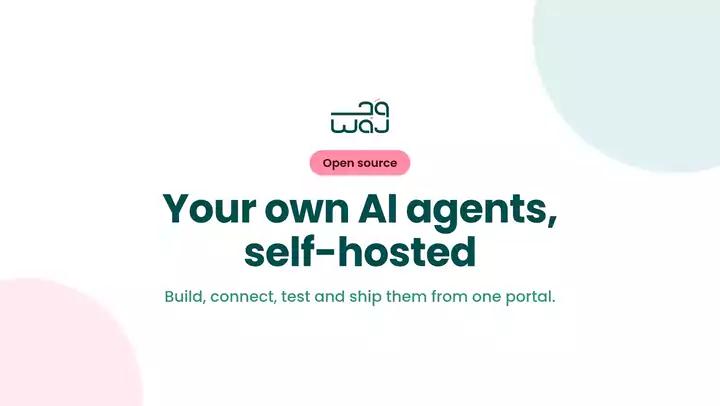

# WAJ AI Engine

**Describe the agent you want, and an AI assistant builds, tests and ships it. A self-hosted agent platform your assistant operates over MCP, with a portal for everything else. No agent code.**

[](LICENSE)
[](https://github.com/waj-1/ai-engine/actions/workflows/ai-agent-tests.yaml)
[](https://github.com/waj-1/ai-engine/releases)
[](https://github.com/waj-1/ai-engine/discussions)
[](https://glama.ai/mcp/servers/waj-1/ai-engine)

### ▶ [Try the live demo](https://engine-demo.waj.ai)

One click, no sign-up. Open **Build with AI** and type or say "build me a support
agent that checks outages": the assistant creates it, gives it tools and knowledge,
tests it, and changes it when you follow up ("name it Ali", "make it shorter"). On
your own install the same conversation happens in Claude Code, Cursor or any MCP
client ([Connect your AI assistant](#connect-your-ai-assistant)). The demo resets
every night.

### ▶ [Call or chat with a live voice agent](https://waj.ai/waj-ai-engine#demo)

Want to hear a finished agent first? Four voice and chat agents of a made-up
telecom (collections, upgrade offers, support, plans and pricing) take calls in
English and Arabic, in your browser. Pick a scenario and play the customer.

<!-- overview-video -->
[](docs/media/overview/engine-overview.mp4)

▶ [Watch with sound](docs/media/overview/engine-overview.mp4) (35 s) · [Video tour of every section](docs/partner/README.md#watch-it-first)
<!-- /overview-video -->

## Quick start

```bash
git clone https://github.com/waj-1/ai-engine.git
cd ai-engine
docker compose up
```

Open **http://localhost:8000**. You need Docker and nothing else. The
first-run page asks for the setup code printed by `docker compose logs engine`,
then creates your admin account and shows your API key. No model key is needed
to start: add one later, or use a local model. The full walkthrough is in
[docs/quick-start.md](docs/quick-start.md).

[](https://render.com/deploy?repo=https://github.com/waj-1/ai-engine)

More ways to run it: [Docker Compose](docs/deploy/compose.md) · [Coolify](docs/deploy/coolify.md) · [Railway](docs/deploy/railway.md) · [Render](docs/deploy/render.md).
The image is published for amd64 and arm64 at `ghcr.io/waj-1/ai-engine`.

## Features

An agent here is a row of configuration: instructions, a model, tools from the
MCP servers you connect, and optionally other agents it can hand off to.
Changing an agent is an edit, with nothing to rebuild.

- **Admin portal.** Create, edit and publish agents at `/admin`. [Guide](docs/partner/README.md)
- **Admin MCP server.** Your AI assistant builds and tests agents at `/mcp`, with the same steps as the portal. [Connect your AI assistant](#connect-your-ai-assistant)
- **Chat API.** Each published agent answers at `POST /v1/agents/{slug}/chat`, streamed. [Talk to an agent](#talk-to-an-agent)
- **OpenAI-compatible API.** `/v1/chat/completions` and `/v1/models`, so OpenAI SDKs and chat apps can use an agent as a model. [docs/openai-compatible.md](docs/openai-compatible.md)
- **Voice.** Calls at `WS /v1/agents/{slug}/voice` with Gemini Live or Azure Voice Live. [docs/voice.md](docs/voice.md)
- **Knowledge bases.** Upload documents and the agent gets a search tool. [Guide](docs/partner/03-knowledge/01-knowledge-bases.md)
- **Test suites and model comparison.** Measure a change to the instructions or the model before it ships. [Test a change](#test-a-change-before-it-ships)
- **Agent teams.** A parent agent hands off to specialist agents. [Guide](docs/partner/02-agents/04-sub-agents.md)
- **Local models.** A model served by Ollama needs no API key. [docs/local-models.md](docs/local-models.md)
- **Claude plugin.** Skills that build, test and improve agents from Claude Code. [Plugin](#claude-code-plugin)

This is an early release. What is in this README works today on a fresh
database. If it is useful to you, a star helps other people find it.

## How it compares

Dify, Flowise and Langflow are mature, much larger projects built around a
visual canvas (Flowise was archived in August 2026). This one is young and
takes a different route.

| | WAJ AI Engine | Dify | Flowise | Langflow |
|---|---|---|---|---|
| How you build | Configuration, from a portal or over MCP | Visual workflow canvas | Visual canvas | Visual canvas |
| License | Apache-2.0 | Apache-2.0 with added conditions (multi-tenant use, logo) | Apache-2.0, with enterprise directories under a commercial license | MIT |
| Maturity | Early release | Since 2023 | Since 2023, archived August 2026 | Since 2023 |

Choose one of them for a drag-and-drop canvas and a large library of ready
integrations. Choose this when you want your tools to come from MCP servers,
your AI assistant to do the building, and tests in front of every change.

Detailed comparisons: [docs/compare/](docs/compare/README.md).

## Build an agent

In the portal:

1. **Agents › Models › New model**: add a model.
2. **Connections › Connect server**: the address of an MCP server that exposes
   your systems. Untick the tools agents should never use.
3. **Agents › New agent**: pick a template, name the agent and choose its
   model. "Support desk" answers at `/v1/agents/support-desk/chat`.
4. On the agent: write **Instructions**, choose **Tools & knowledge**, and set
   Status › Active under **Settings** to publish.
5. **Test**, on the agent's page, talks to it, draft or published.

More: [create an agent](docs/partner/02-agents/07-new-agent.md),
[agent teams](docs/partner/02-agents/04-sub-agents.md),
[categories](docs/partner/02-agents/09-categories.md).

## Talk to an agent

The chat API takes an API key. Use the key from first-run setup, or create one
with **Chat only** access under **Settings › API keys**.

```bash
export AI_ENGINE_API_KEY=wae_...

curl -N http://localhost:8000/v1/agents/demo/chat \
  -H "Authorization: Bearer $AI_ENGINE_API_KEY" -H "Content-Type: application/json" \
  -d '{"message": "What can you help me with?"}'
```

The reply streams as server-sent events: a `session` event, the answer in
`answer` chunks, then `usage` and `done`. To continue the conversation, send
the `session` event's `id` back as `session_id`. Each key has its own
conversations, and `GET /ai/sessions` with the key lists them.

- From an OpenAI client: [docs/openai-compatible.md](docs/openai-compatible.md)
- By voice: [docs/voice.md](docs/voice.md)
- Keys: [create and revoke API keys](docs/partner/08-team-and-settings/04-api-keys.md)

## Connect your AI assistant

The admin MCP server at `/mcp` takes an API key with **Full access**. Add it
to Claude, Cursor or any MCP client:

```json
{
  "mcpServers": {
    "waj-ai-engine": {
      "type": "http",
      "url": "http://localhost:8000/mcp",
      "headers": { "Authorization": "Bearer wae_..." }
    }
  }
}
```

The tools for each build step are listed in
[docs/connect-your-assistant.md](docs/connect-your-assistant.md).

### Claude Code plugin

The [plugin](plugin/README.md) sets the server up and adds skills that build
an agent, test it, improve its instructions and compare models:

```
/plugin marketplace add waj-1/ai-engine
/plugin install waj-ai-engine@waj-ai-engine
```

## Test a change before it ships

From **Testing** in the portal, or over MCP: write test suites (a question,
the words or tool calls the answer must contain, or a rubric for a judge
model), run them against any agent, draft or published, and compare two runs
case by case. A suite can also run against a draft of the instructions without
serving it, or on another model.

More: [testing guide](docs/partner/06-testing/README.md),
[the MCP tools for each step](docs/connect-your-assistant.md#test-over-mcp).

To run a suite on every pull request, use the
[GitHub Action](https://github.com/waj-1/ai-engine-test-action): it fails the
job when the pass rate drops.

## Configuration

`docker compose up` generates what the stack needs and turns on the chat API
and the MCP server. `.env.example` lists every variable the engine reads, and
[docs/quick-start.md](docs/quick-start.md#configuration) explains the ones
worth knowing. Model providers: Google Gemini, OpenAI, Azure OpenAI,
Anthropic, Ollama, and any OpenAI-compatible endpoint. Running, upgrading and
backing up the stack: [docs/deploy/compose.md](docs/deploy/compose.md).

## Contributing and security

Issues and pull requests are welcome. See [CONTRIBUTING.md](CONTRIBUTING.md),
and [docs/development.md](docs/development.md) for how to run the tests.
Please report vulnerabilities privately as described in
[SECURITY.md](SECURITY.md).

## License

Apache-2.0. See [LICENSE](LICENSE).
