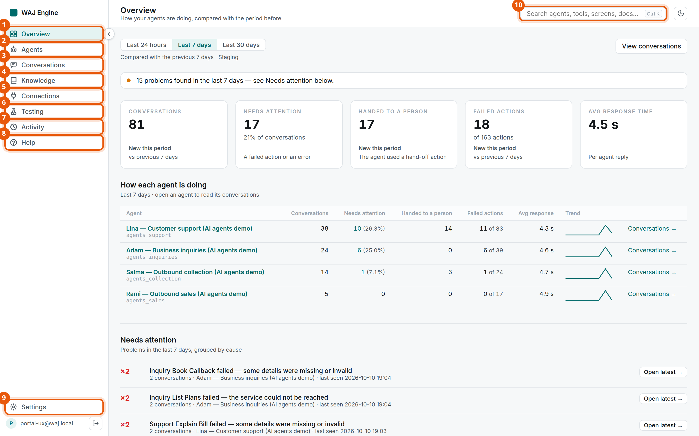

# Welcome to the portal

The portal is where you build, test and watch over your AI agents. This page shows what each part of the sidebar is for.

## What's where

1. **Overview**: how your agents are doing right now: conversations, problems, hand-offs to a person and reply speed. See [Read the Overview](../05-monitor/01-overview.md).
2. **Agents**: every agent, and everything about it: what it's told (instructions), what it can do (tools and knowledge), its voice and its saved versions. See [Your agents](../02-agents/01-your-agents.md).
3. **Conversations**: real conversations with your customers. Read them, listen to calls and see where something went wrong. See [Review a conversation](../05-monitor/02-review-a-conversation.md).
4. **Knowledge**: the documents your agents answer from, reusable skills, and what agents remember about people. See [Knowledge bases](../03-knowledge/01-knowledge-bases.md).
5. **Connections**: tools and integrations that let agents look things up or take actions, and the channels customers use to reach you. See [Tools and integrations](../04-connections/01-tools-and-integrations.md).
6. **Testing**: test suites that check whether each agent is good enough, before and after you change it. See [Testing overview](../06-testing/01-testing-overview.md).
7. **Activity**: a record of who changed what, and when. See [Activity](../08-team-and-settings/02-activity.md).
8. **Help**: these guides.
9. **Settings**: your team and the daily voice-call allowance. See [Team and access](../08-team-and-settings/01-team.md).
10. **Search**: press **Ctrl K** (**⌘ K** on a Mac) from any screen to jump to a screen, an agent or a guide. See [Find anything](03-find-anything.md).

## A few words you'll see

- An **agent** is one AI assistant with one job, such as customer support or outbound collection calls.
- Its **instructions** are what it's told before every conversation.
- A **conversation** is one chat or call between an agent and a customer.
- A **test suite** is a set of practice conversations with the answers you expect.

The [Glossary](../09-reference/01-glossary.md) explains every term.

## Tips

- The **‹** button next to the sidebar shrinks it to icons. Click it again to bring the labels back.
- The moon button at the top right switches between light and dark mode.
- Some portals show a **STAGING / PRODUCTION** switch at the top right. You make changes on Staging and promote them to Production; a red **Production** banner shows while you work on Production. See [Make your changes live](../07-publishing/01-publish-changes.md).
- Most screens have tabs along the top. The tab you're on is underlined.

**Related:** [Your first 15 minutes](02-first-15-minutes.md) · [Find anything](03-find-anything.md) · [Glossary](../09-reference/01-glossary.md)
