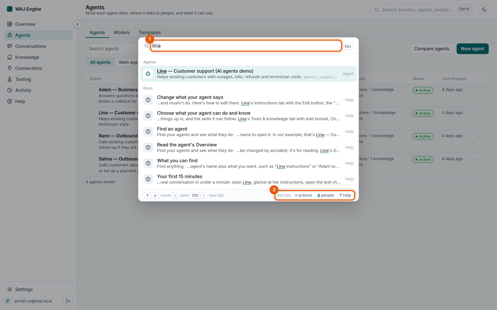

# Find anything

Search jumps you straight to any screen, agent, guide or conversation, so you don't have to remember where things live.

*1 — type here. 2 — start with >, @ or ? to look in one place only.*

## Open search

1. Press **Ctrl K** (**⌘ K** on a Mac) from any screen, or click the search box at the top right.
2. Start typing. Results appear as you type, grouped by kind, with the words you typed highlighted.
3. Use **↑** and **↓** to move through the results and **Enter** to open one. **Ctrl Enter** (**⌘ Enter** on a Mac) opens it in a new tab. **Esc** closes search.

Before you type anything, search shows your recent items and quick actions such as **New agent**, **Run a test**, **Open Help** and **Read recent conversations**.

## What you can find

- **Screens and tabs**: any part of the portal, including old names. "Dashboard" finds **Overview**, and "Traces" finds **Conversations**.
- **Agents and their tabs**: type an agent's name plus what you want, such as "Lina instructions" or "Adam tools". You land on that tab of the agent.
- **Your things**: tools, knowledge bases, skills, channels, test suites and their latest runs, model comparisons, voice checks and team members.
- **Help**: these guides, including words inside a page. A result opens the guide at the right heading.
- **Conversations and people**: a customer's name, phone number or email, or a conversation reference. To protect privacy, names and numbers show partly hidden, such as "Cristel T." or "+971 ••• 9901".

## Narrow your search

Start your search with one of these signs to look in one place only:

| Type | To search |
|---|---|
| `>` | Actions, such as "> new agent" |
| `@` | People, such as "@cristel" |
| `?` | Help guides, such as "? publish" |

The signs are also listed at the bottom of the search window.

## If you can't find something

- Check the spelling, or try a shorter word.
- People only show up if they've had a conversation with one of your agents.
- Words said inside a conversation can't be searched. Search for the customer or use the filters in **Conversations** instead.
- If a part of search is slow to answer, it's skipped and a short note says so. Try again in a moment.

**Related:** [Welcome to the portal](01-welcome.md) · [Review a conversation](../05-monitor/02-review-a-conversation.md) · [Glossary](../09-reference/01-glossary.md)
