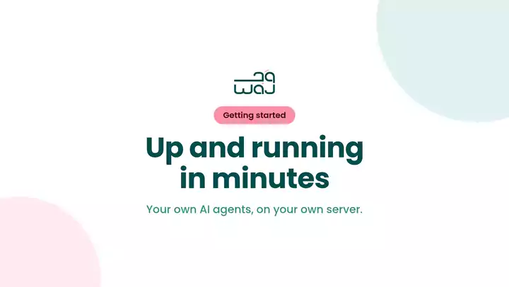
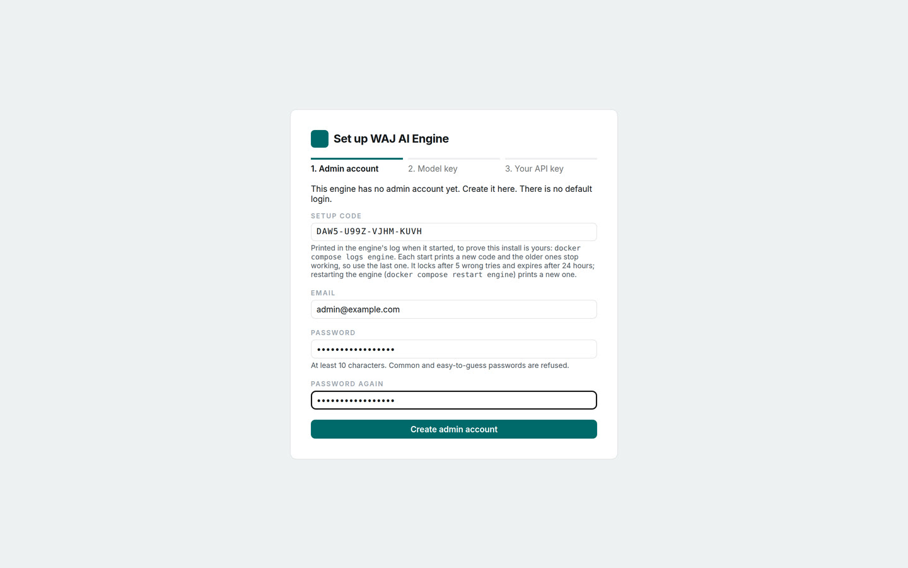
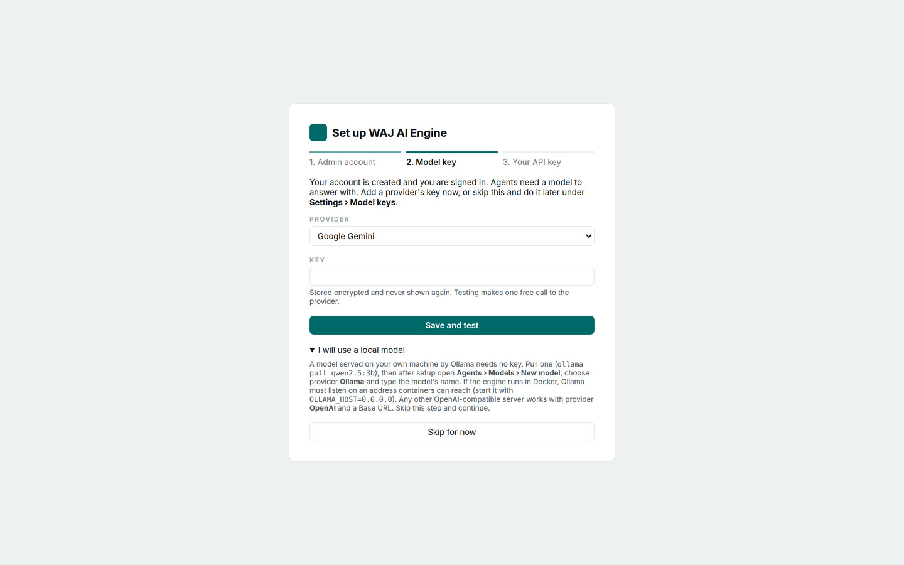
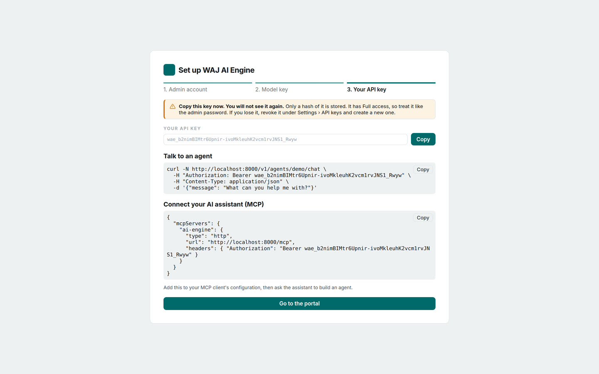
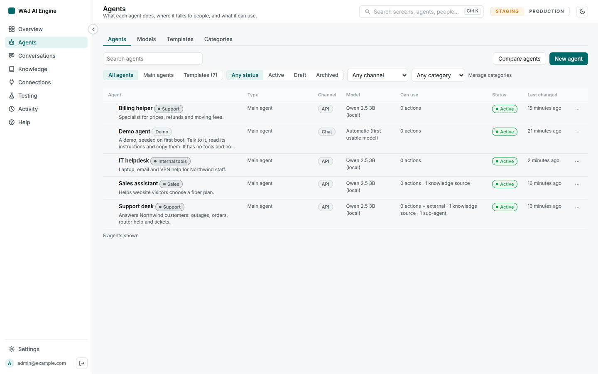
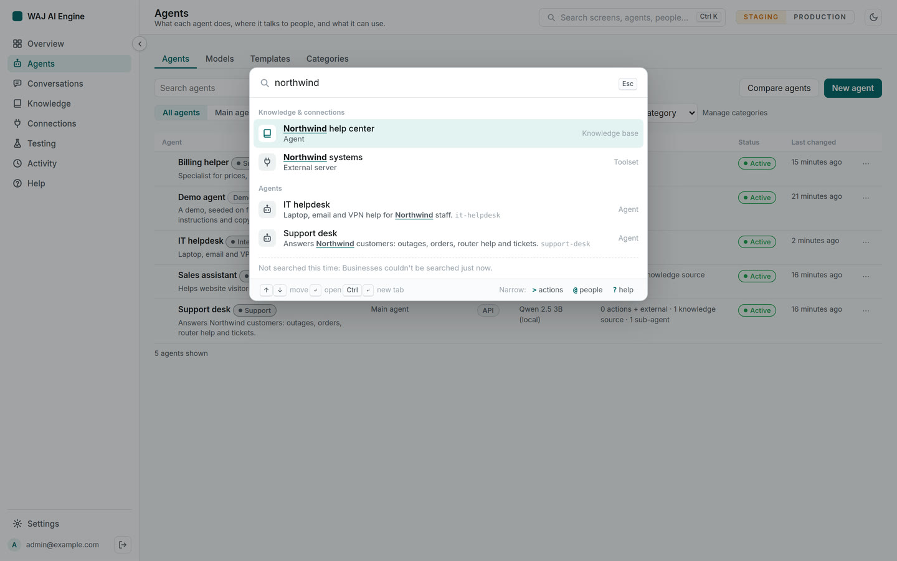

# Getting started: up and running in minutes

▶ **Full video with sound:** [engine-getting-started.mp4](media/engine-getting-started.mp4) (36 s)

Start the engine with one command and a first-run page walks you through the rest. You claim the install with a one-time setup code, choose a cloud model or a local one, and leave with an API key, a ready `curl` command and MCP settings. Then the portal puts your agents, conversations, knowledge and tests in one place.

**Where:** http://localhost:8000 after `docker compose up` · **Guides:** [Set up a new install](04-set-up-a-new-install.md), [Welcome to the portal](01-welcome.md), [Find anything](03-find-anything.md), [The public demo and Build with AI](05-public-demo.md)

## How it works

### 1. Create the admin account
There is no default login. Paste the setup code printed by `docker compose logs engine`, then choose the admin email and a password of at least 10 characters.

### 2. Add a model, or use a local one
Pick a provider (Google Gemini, OpenAI, Anthropic or Azure OpenAI), paste its key and click **Save and test**. The key is stored encrypted and never shown again. Or open **I will use a local model** to run one with Ollama and no key at all.

### 3. Copy your API key
Your API key is shown once, with a `curl` call to the demo agent and the settings for an MCP client. Only a hash of the key is stored.

### 4. Find your way around
The sidebar holds Overview, Agents, Conversations, Knowledge, Connections, Testing, Activity and Help, with Settings at the bottom.

### 5. Find anything with Ctrl K
Press **Ctrl K** (**⌘ K** on a Mac) and type. Results cover screens, agents, knowledge, connections and guides, and you can jump straight to a tab such as an agent's instructions.

## Good to know
- The first-run page is gone once the admin account exists. Set `ADMIN_EMAIL` and `ADMIN_PASSWORD` before the first start to skip it.
- Each start of the engine prints a new setup code, and five wrong tries lock the page until the next start.
- You can add or change model keys later under **Settings › Model keys**.

## In this section
- [Welcome to the portal](01-welcome.md): what each part of the sidebar is for.
- [Your first 15 minutes](02-first-15-minutes.md): look at an agent, test it and read a real conversation.
- [Find anything](03-find-anything.md): jump to any screen, agent or guide with Ctrl K.
- [Set up a new install](04-set-up-a-new-install.md): the first-run page, for an install nobody has signed in to yet.
