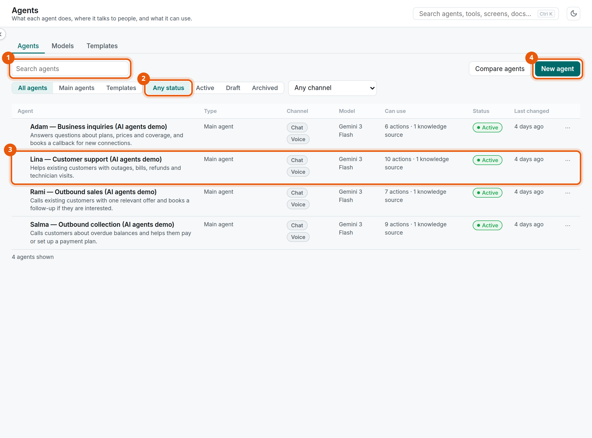
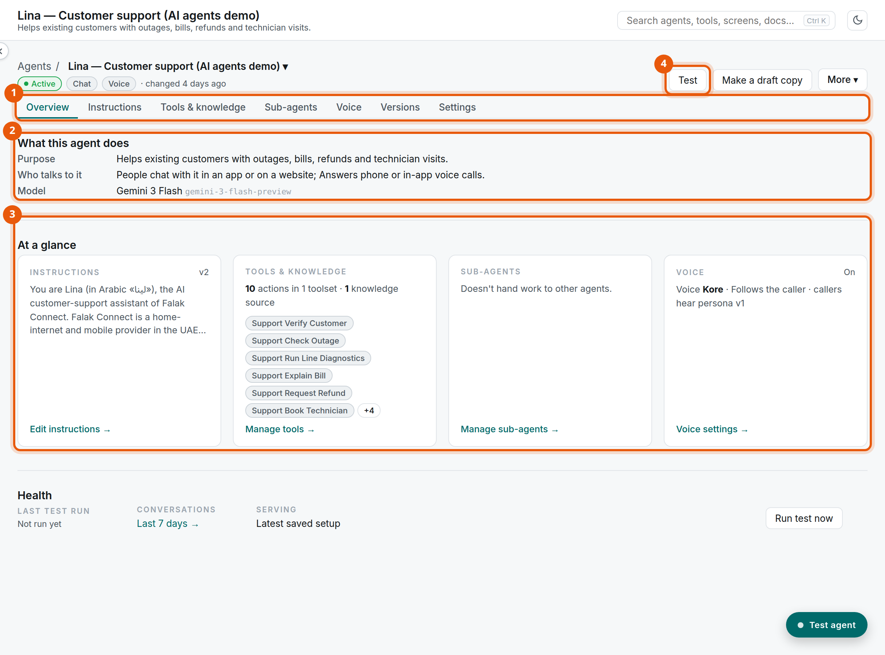

# Find your agents and see what they do

The **Agents** page lists every agent in your portal. Open one to see, on a single screen, what it does, who talks to it and what it can use.

## Find an agent

1. Type part of a name or description in **Search agents**.
2. Narrow the list with the filters: **Main agents** or **Templates**, a status (**Active**, **Draft**, **Archived**), **Any channel** (Chat, Voice and so on) and, once you have made some, **Any category**. See [Group your agents into categories](09-categories.md).
3. Click an agent's name to open it. In our example, that's **Lina — Customer support**.
4. **New agent** starts a new one from a template. See [Create a new agent](07-new-agent.md).

Each row tells you:

- **Type**: a main agent that people talk to, or a sub-agent that only works when another agent hands it a question.
- **Channel**: where people reach it, such as **Chat** (an app or website) or **Voice** (phone or in-app calls).
- **Can use**: how many actions and knowledge sources it has.
- **Status**: **Active** agents serve people. **Draft** and **Archived** agents don't.
- **Last changed**: when someone last saved a change, and who.

An agent that is in a [category](09-categories.md) shows the category's coloured label next to its name.

A new install may list a **Demo agent**, marked **Demo**. It was created automatically so you have something to talk to and to copy: open it, read its **Instructions**, and try **Test**. If it replies that no model is configured, add one under **Agents › Models** and try again. Archive it when you no longer need it; it won't come back.

The **⋯** menu at the end of a row opens the agent, starts a test chat, or jumps to its version history.

## Read the agent's Overview

When you open an agent, you land on its **Overview**. Nothing on this tab can be changed by accident; it's for reading.

1. The tabs across the top hold everything you can change: **Instructions**, **Tools & knowledge**, **Sub-agents**, **Voice**, **Versions** and **Settings**.
2. **What this agent does** shows its purpose (the description), who talks to it and which AI model writes its answers.
3. **At a glance** sums up each tab. Click a card to go straight to that tab.
4. **Test** opens a chat with the agent so you can try it. See [Test your agent](08-test-your-agent.md).

Lower down, **Health** shows the last automatic test result and links to the last 7 days of conversations.

To change the description, open **Settings**, edit **Description** and click **Save settings**. Keep it to one plain sentence. Other agents read it to decide when to hand this agent a question.

**Related:** [Change what your agent says](02-instructions.md) · [Group your agents into categories](09-categories.md) · [Test your agent](08-test-your-agent.md) · [Make your changes live](../07-publishing/01-publish-changes.md) · [Glossary](../09-reference/01-glossary.md)
