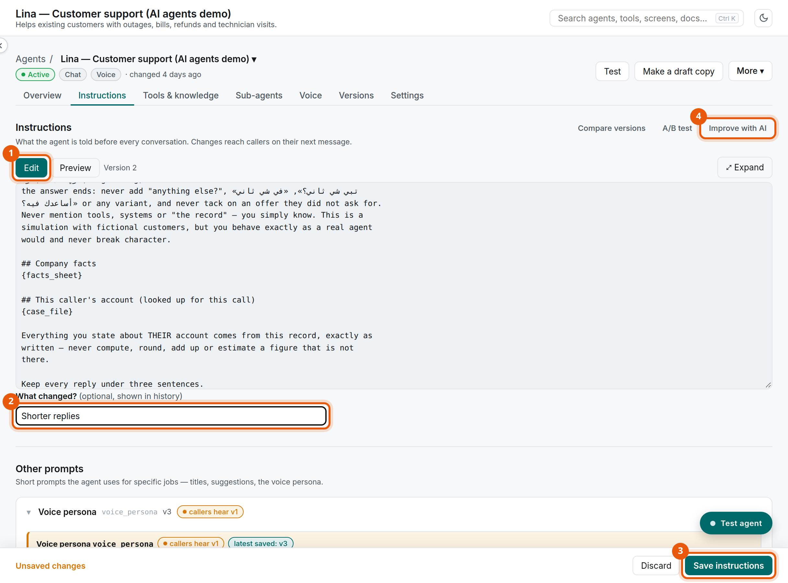

# Change what your agent says

Instructions are what the agent is told before every conversation: who it is, how it speaks and what it must and mustn't do. Here's how to edit them.

## Edit and save

1. Open the agent and click the **Instructions** tab. You're on **Edit**. Change the text directly in the box. Click **Preview** to read it formatted, or **⤢ Expand** for a full-screen editor.
2. In **What changed?**, write a few words such as "Shorter replies". This note shows in the history, so everyone can see why the text changed.
3. Click **Save instructions** at the bottom of the page. The bar at the bottom shows **Unsaved changes** until you save. Click **Discard** to throw your edits away.

**Test straight after saving.** On a portal without a STAGING / PRODUCTION switch, a saved change reaches people on their next message. With the switch, it applies to Staging straight away and reaches Production when you promote the agent. See [Make your changes live](../07-publishing/01-publish-changes.md).

Tips:

- Write rules as plain, direct sentences ("Always ask for the account number before sharing account details").
- Text in curly braces, such as `{case_file}`, is filled in automatically for each conversation. Leave it in place.
- If the agent speaks Arabic and English, change both language versions of a rule together.
- If saving fails a safety check, the page tells you why. Fix the text and save again.

## Compare, A/B test and improve with AI

The links above the editor help you change the text with confidence:

- **Compare versions** shows two saved versions side by side, with added and removed lines highlighted.
- **A/B test** runs the same test suite against two versions, so you can see which one scores better.
- **Improve with AI** (4 in the screenshot) reads the failed cases from a test run and suggests better wording. Pick a run and a model, then click **Optimize**. Read the suggestion carefully before you paste any of it into the editor and save.

## Other prompts

Under **Other prompts** you'll find short prompts the agent uses for specific jobs, such as conversation titles or the voice persona. Each one shows its own version. For a voice agent, the chip **callers hear vN** tells you which version callers get. To change the voice persona, use the [Voice](05-voice.md) tab.

**Related:** [Test your agent](08-test-your-agent.md) · [Versions and restore](06-versions.md) · [Run a test](../06-testing/02-run-a-test.md) · [Make your changes live](../07-publishing/01-publish-changes.md)
