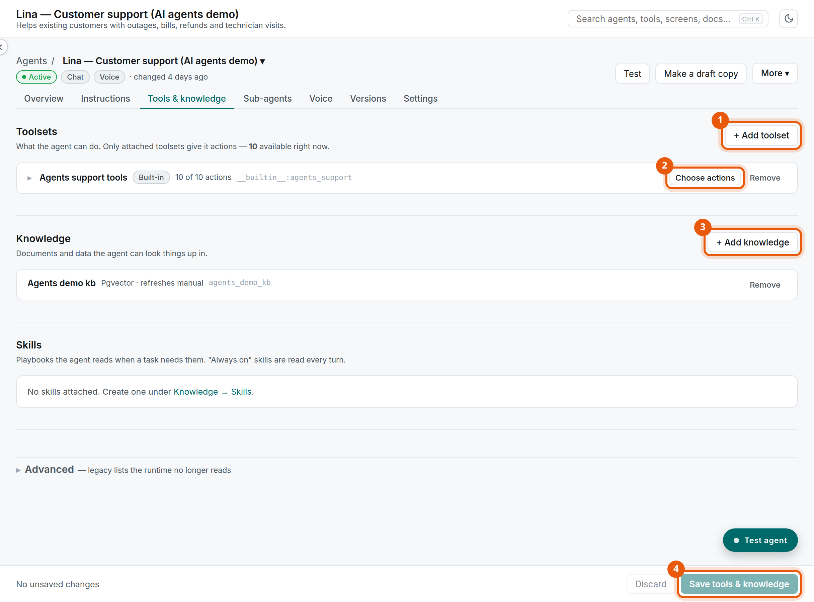
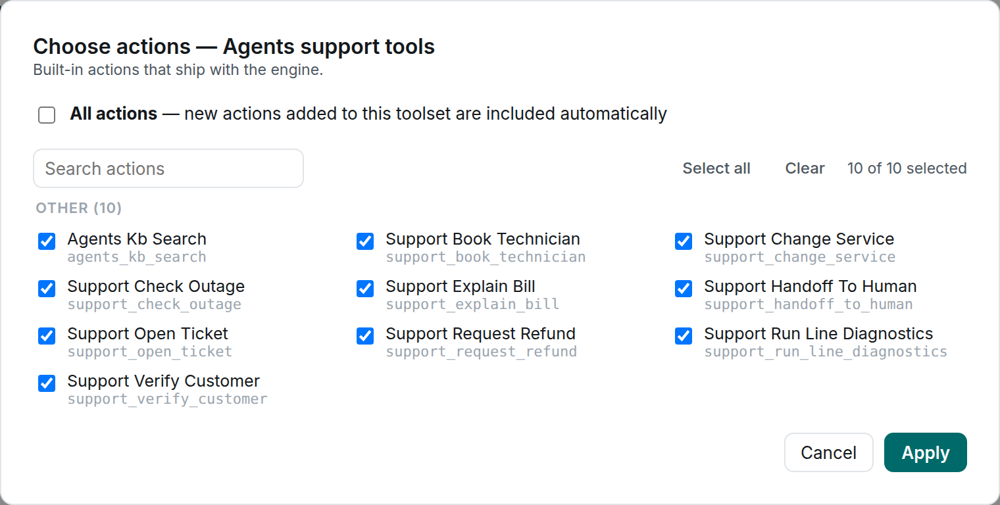

# Choose what your agent can do and know

The **Tools & knowledge** tab controls three things: the actions the agent can take, the documents it can look things up in, and the skills it can follow.

## Toolsets: what the agent can do

A **toolset** is a group of related actions, such as "check an outage" or "book a technician". The agent can only use actions from toolsets attached here.

1. Click **+ Add toolset**, search for the one you need and pick it.
2. On an attached toolset, click **Choose actions** to decide exactly which of its actions the agent may use (see below). **Remove** detaches the whole toolset.
3. Knowledge works the same way: click **+ Add knowledge** and pick a knowledge base. See the Knowledge section below.
4. Click **Save tools & knowledge**. Until you save, the bar at the bottom shows **Unsaved changes**.

Each toolset row shows how many of its actions are switched on, for example "10 of 10 actions". Click the arrow on the left of the row to see their names.

### Choose actions

- Tick **All actions** to give the agent every action in the toolset, including any added to it later.
- Otherwise, tick only the actions you want. Use **Search actions** to find one, or **Select all** and **Clear**.
- Click **Apply**, then **Save tools & knowledge**.

Give an agent only the actions it needs. For example, a support agent like Lina doesn't need sales actions. Fewer actions mean fewer mistakes and faster answers.

Adding an action doesn't tell the agent *when* to use it. If it should always do something first (for example, verify the customer), say so in its [instructions](02-instructions.md).

## Knowledge

Knowledge sources are documents and data the agent can search before it answers, such as your help articles or policies. Lina has one: the support knowledge base. To create a knowledge base or upload documents, see [Knowledge bases](../03-knowledge/01-knowledge-bases.md).

## Skills

Skills are reusable playbooks the agent reads when a task needs them. Skills marked "Always on" are read on every turn. Click **+ Add skill** to attach one. If you haven't made any yet, create them under **Knowledge → Skills**. See [Skills](../03-knowledge/02-skills.md).

## Advanced

You can usually leave **Advanced** as it is. It holds older lists kept for engineers.

**Related:** [Tools and integrations](../04-connections/01-tools-and-integrations.md) · [Knowledge bases](../03-knowledge/01-knowledge-bases.md) · [Test your agent](08-test-your-agent.md) · [Make your changes live](../07-publishing/01-publish-changes.md)
