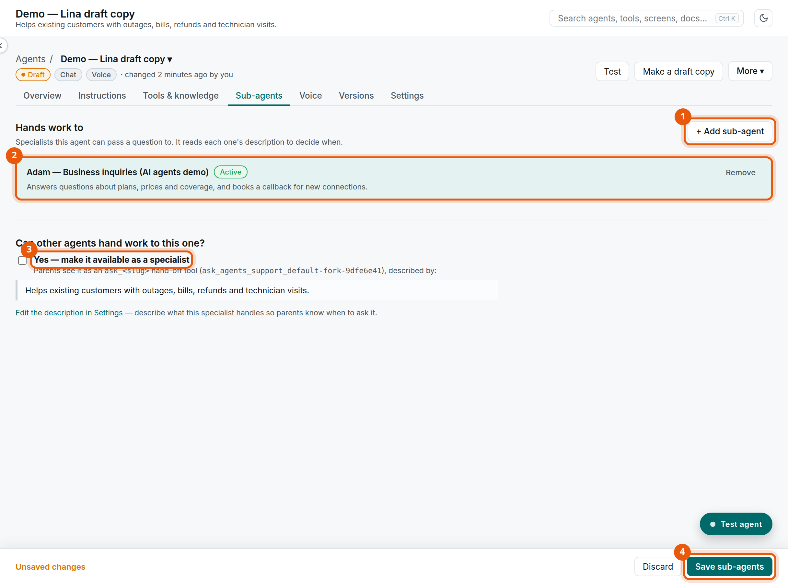

# Let your agent hand off to other agents

A main agent can pass a question to a **sub-agent**, a specialist that's better at one job. For example, a support agent could hand a "which plan should I buy?" question to a sales specialist. You set this up on the **Sub-agents** tab.

## Add a sub-agent

1. Open the main agent, click the **Sub-agents** tab, then click **+ Add sub-agent**. Search for the specialist and pick it.
2. It appears under **Hands work to**, with its description. **Remove** takes it off again.
3. If you're setting up the *specialist* itself, tick **Yes — make it available as a specialist** under **Can other agents hand work to this one?**. Only specialists are offered to other agents.
4. Click **Save sub-agents**.

## How the agent decides when to hand off

The main agent reads each sub-agent's **description** to decide when to ask it. A clear description is the most important part of a hand-off:

- Good: "Answers questions about plans, prices and coverage, and books a callback for new connections."
- Too vague: "Sales agent."

To change a description, open the sub-agent, go to **Settings**, edit **Description** and click **Save settings**. The **Edit the description in Settings** link on this tab takes you there.

If the main agent should hand off in specific situations, say so in its [instructions](02-instructions.md) too, for example: "For questions about new plans, ask the sales specialist."

## Good to know

- A sub-agent only runs when its parent hands it work. People never talk to it directly.
- The parent passes on the question, and the sub-agent's answer comes back through the parent. The person sees one conversation.
- Each hand-off adds a little time to the reply. Keep hand-offs for questions that really need the specialist.
- You can also create a new agent as a sub-agent straight away. See [Create a new agent](07-new-agent.md).

After saving, [test the main agent](08-test-your-agent.md) with a question meant for the specialist, and check that the hand-off happens.

**Related:** [Choose what your agent can do and know](03-tools-and-knowledge.md) · [Create a new agent](07-new-agent.md) · [Glossary](../09-reference/01-glossary.md)
