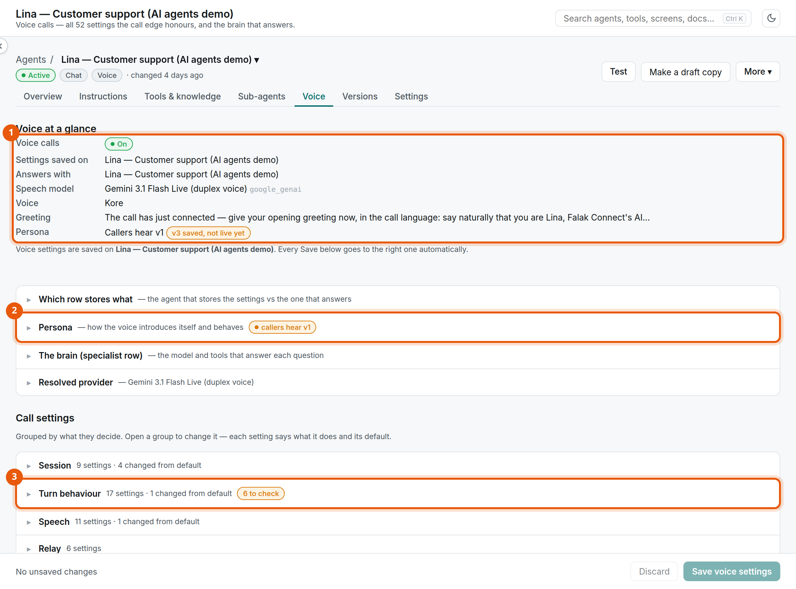

# Set up how your agent sounds on calls

If an agent takes phone or in-app voice calls, it has a **Voice** tab. That's where you choose its voice and language, what it says when a call connects, and how it takes turns with the caller.

## 1. Check the summary first

**Voice at a glance** shows the current setup:

- **Voice calls**: **On** or off.
- **Speech model**: the model that listens and speaks on the call.
- **Voice**: the voice callers hear (Lina uses **Kore**).
- **Greeting**: what the agent is told to do when the call connects.
- **Persona**: which version of the voice persona callers hear right now, for example **Callers hear v1**. A chip such as **v3 saved, not live yet** means a newer version exists that callers don't get yet.

## 2. Change the persona

The **Persona** describes how the agent introduces itself and behaves on a call: its name, tone and language rules.

1. Click **Persona** to open it, then edit the text.
2. Add a short note in **What changed?** and click **Save voice settings** at the bottom of the page.

Saving makes your new version the one callers hear, from their next call. The **callers hear** chip updates to match.

## 3. Change call settings

Under **Call settings**, the settings are grouped by what they decide. Each group shows how many of its settings differ from the default, and a **to check** chip marks settings worth a second look.

- **Session**: whether voice is on, the **Voice ID**, **Voice by language**, the call **Language** and the **Greeting trigger** (what the agent does as soon as the call connects).
- **Turn behaviour**: turn-taking, such as whether callers can interrupt the agent (**Barge-in enabled**) and what happens when an answer is slow.
- **Speech**: what callers hear that isn't an answer, such as the holding line ("one moment…"), the failure line and the speaking rate.
- **Relay**, **Limits** and **Recognition**: protected flows, call limits, and words to listen out for.

To change a setting, open its group, edit the field and click **Save voice settings** at the bottom of the page. Clear a field to go back to its default. Changes apply from the next call.

You can usually leave **Which row stores what**, **The brain**, **Relay**, **Limits** and the technical fields as they are. Ask your portal administrator before you change them.

## Tips

- Change one thing at a time, then make a test call.
- Don't switch off **Barge-in enabled** unless you mean to: callers then can't interrupt the agent at all.
- Daily call minutes are capped per business. See [Voice budgets](../08-team-and-settings/03-voice-budgets.md).

**Related:** [Change what your agent says](02-instructions.md) · [Voice checks](../06-testing/05-voice-checks.md) · [Review a conversation](../05-monitor/02-review-a-conversation.md) · [Versions and restore](06-versions.md)
