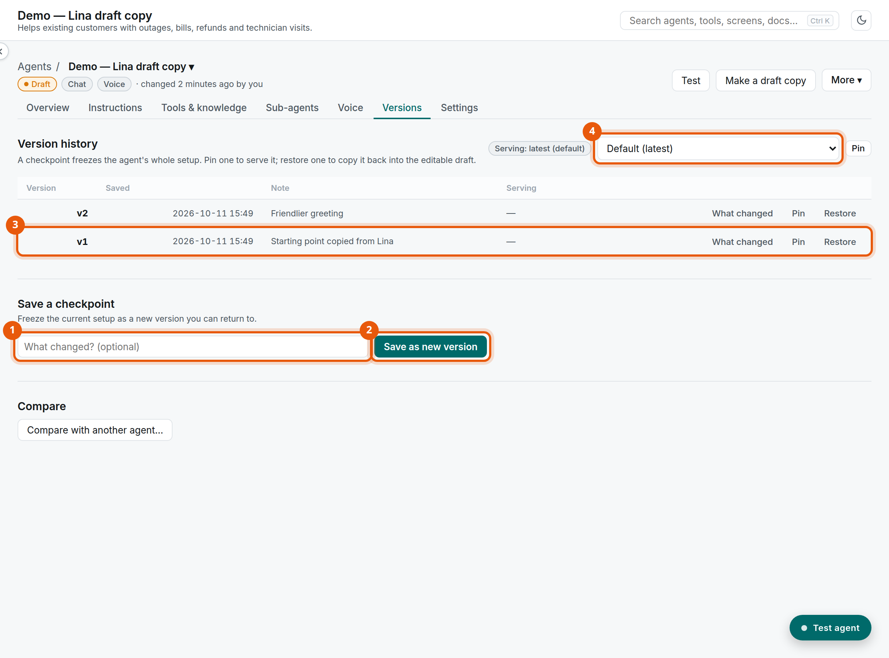

# Save a checkpoint and go back to it

A **checkpoint** (a version) freezes the agent's whole setup: instructions, tools, knowledge, sub-agents, model and voice. Save one before a big change, so you can compare against it or go back to it later. You do this on the **Versions** tab.

## Save a checkpoint

1. Open the agent, click **Versions**, and under **Save a checkpoint** type a short note in **What changed?**, such as "Before shorter replies".
2. Click **Save as new version**. It appears at the top of **Version history** as the next number (v1, v2, v3…).

## Use the version history

3. Each row shows the version number, when it was saved, its note, and whether it's **served**. The buttons on each row:
   - **What changed** shows how that version differs from the agent's current setup.
   - **Restore** copies that version back into the agent's current setup, replacing it. You're asked to confirm first. It's the quickest way to undo a bad change.
   - **Pin** makes people get that exact version, whatever you edit afterwards.
4. The **Serve** picker at the top right does the same as **Pin**. **Serving: latest (default)** means people get the agent as it's set up right now. Choose **Default (latest)** and click **Pin** to go back to that.

### When to pin

Pinning holds a known-good version steady. For example, pin your last checkpoint before a busy weekend, so nothing you or a colleague edits reaches customers by accident. Remember to unpin afterwards (choose **Default (latest)**). Otherwise your later changes never reach anyone.

Pinning affects what people get, including in the **Test** chat. To try out new edits, go back to **Default (latest)** first.

## Compare

- **Compare with another agent…** lines up this agent's setup against another agent's, field by field.
- **Compare versions** on the **Instructions** tab compares two versions of the instructions text only.

## Good habits

- Save a checkpoint before every change you'd want to undo, and write a clear note.
- After a **Restore**, open **Instructions** and the other tabs to check the setup is what you expect, then [test the agent](08-test-your-agent.md).
- The **Activity** page shows who changed what and when. See [Activity](../08-team-and-settings/02-activity.md).

**Related:** [Make your changes live](../07-publishing/01-publish-changes.md) · [Change what your agent says](02-instructions.md) · [Compare results](../06-testing/03-compare-results.md)
