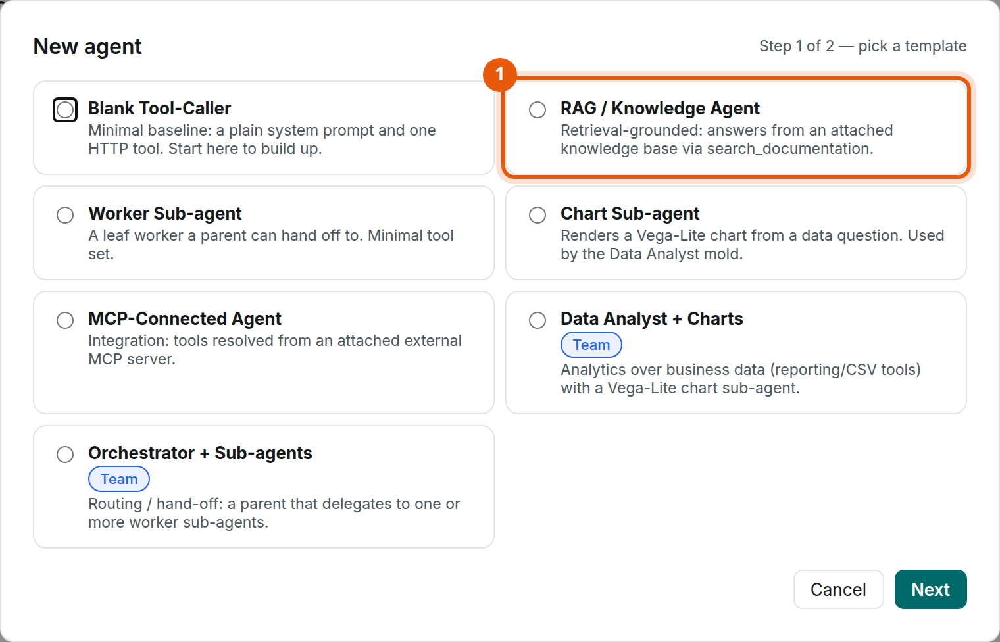
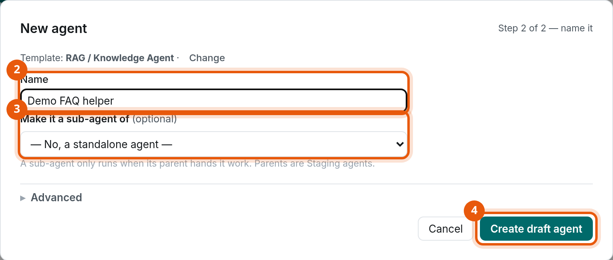

# Create a new agent

New agents start from a **template**: a ready-made starting point that already has sensible instructions and tools. The new agent starts as a **Draft**, so nobody talks to it until you're ready.

## Start from a template

1. On the **Agents** page, click **New agent**. Pick the template closest to what you need, then click **Next**:
   - **Blank Tool-Caller**: a plain starting point with one tool.
   - **RAG / Knowledge Agent**: answers from a knowledge base, such as your help articles.
   - **Worker Sub-agent** and **Chart Sub-agent**: specialists that another agent hands work to.
   - **MCP-Connected Agent**: uses the actions of a connected system.
   - **Team** templates (**Data Analyst + Charts**, **Orchestrator + Sub-agents**) create a main agent with its sub-agents already connected.

2. Give it a clear **Name**, for example "FAQ helper".
3. To make it a specialist for one of your existing agents, choose that agent in **Make it a sub-agent of**. Otherwise leave **— No, a standalone agent —**.
4. Click **Create draft agent**. The new agent opens on its **Overview**.

You can usually leave **Advanced** as it is.

## Finish setting it up

Then work through the tabs:

1. **Settings**: write a one-line **Description** of what the agent does, and check the **Model**.
2. **Instructions**: rewrite the template text for your business. See [Change what your agent says](02-instructions.md).
3. **Tools & knowledge**: attach only the toolsets and knowledge it needs. See [Choose what your agent can do and know](03-tools-and-knowledge.md).
4. **Settings → Status**: switch from **Draft — not served** to **Active — serves people** when it's ready, then click **Save settings**. A specialist uses **Specialist — only via a parent agent**.

A new agent also needs a **channel** (a website, app or phone line) before people can reach it. Ask your portal administrator to connect one. See [Channels](../04-connections/02-channels.md).

## Make a draft copy of an existing agent

To prepare a different setup for an agent you already have, open it and click **Make a draft copy**. The copy opens as a separate agent with the status **Draft**, so nobody is served by it. Rename it in **Settings** so it's easy to tell apart.

Use a copy to prepare and compare changes. **More ▾ → Compare with another agent…** shows the differences against the original. When you're happy, make the same changes on the original agent.

**Check after copying:** open the copy's **Tools & knowledge** tab and confirm its toolsets came across. Re-add any that are missing.

**Note:** a draft copy shares its instructions history with the original agent — saving instructions on the copy changes the original too. Change instructions on the original agent instead, after [saving a checkpoint](06-versions.md).

**Related:** [Find your agents and see what they do](01-your-agents.md) · [Let your agent hand off to other agents](04-sub-agents.md) · [Make your changes live](../07-publishing/01-publish-changes.md)
