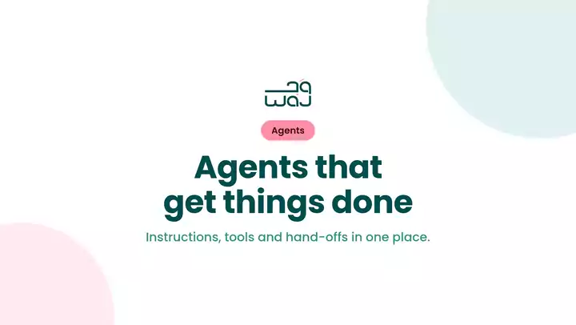
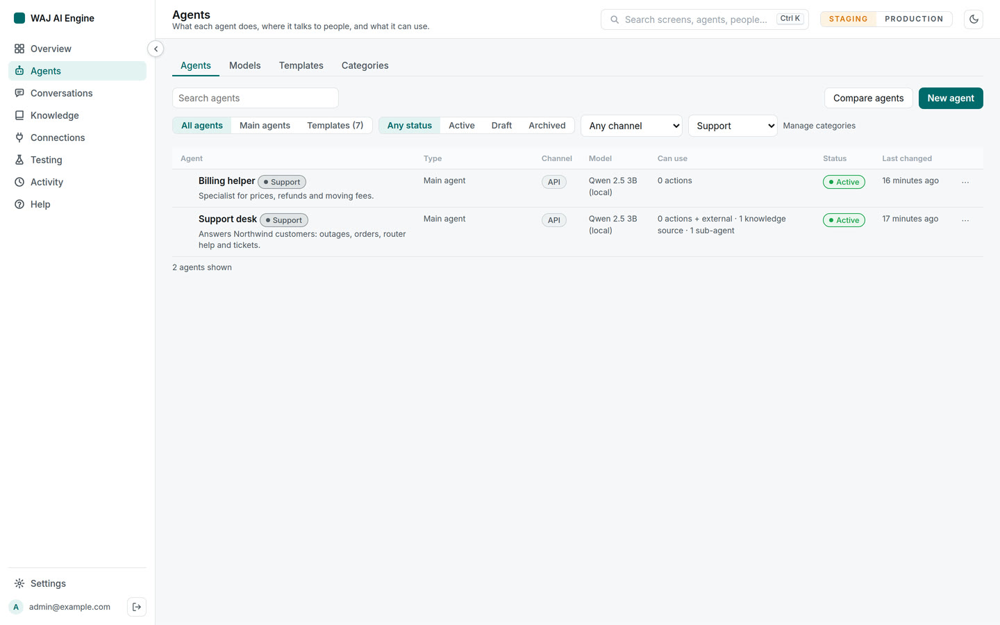
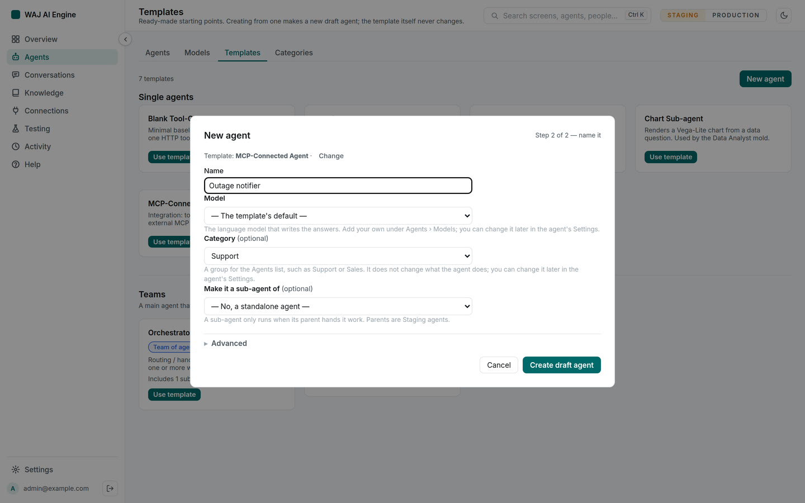
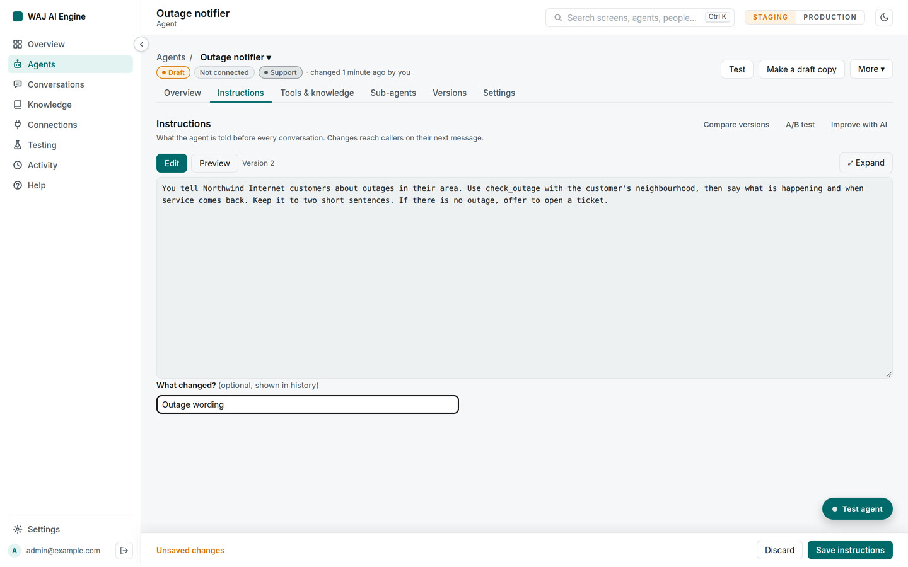
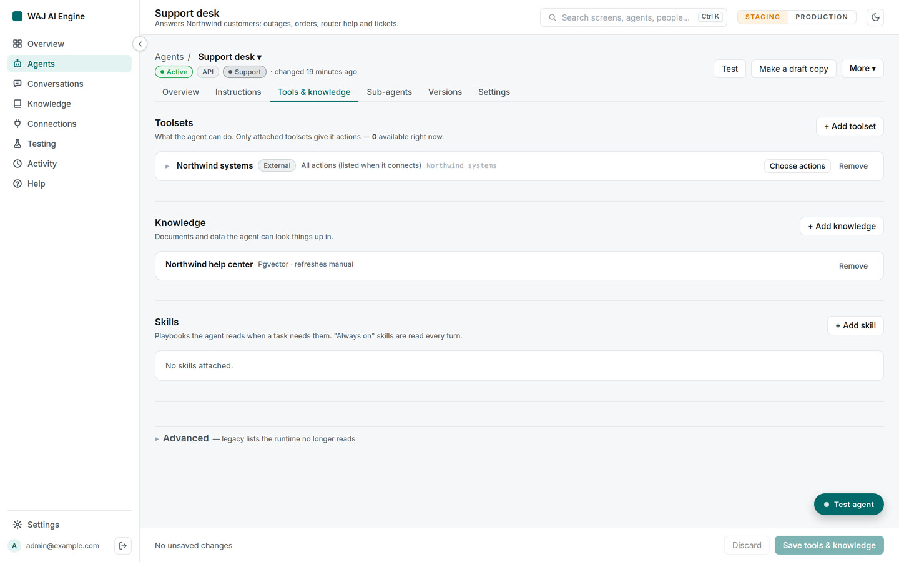
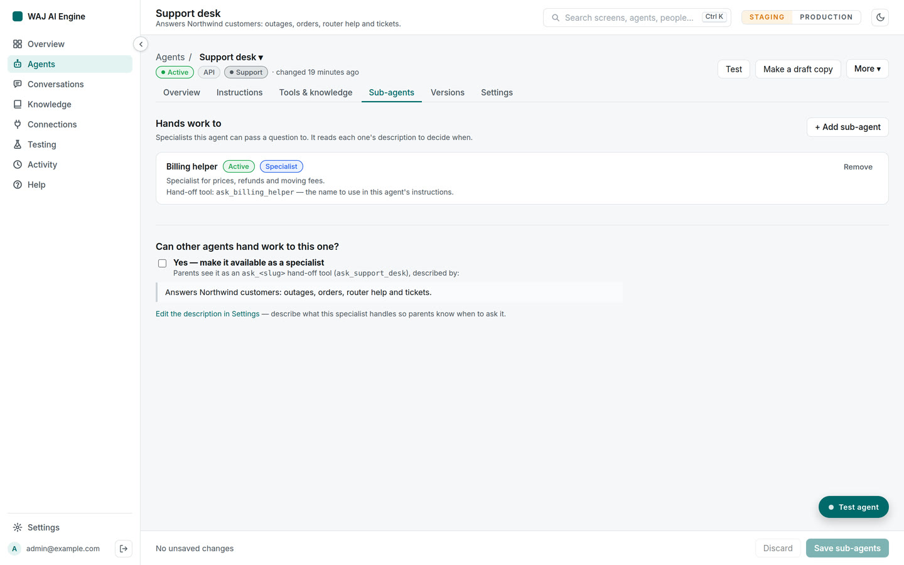
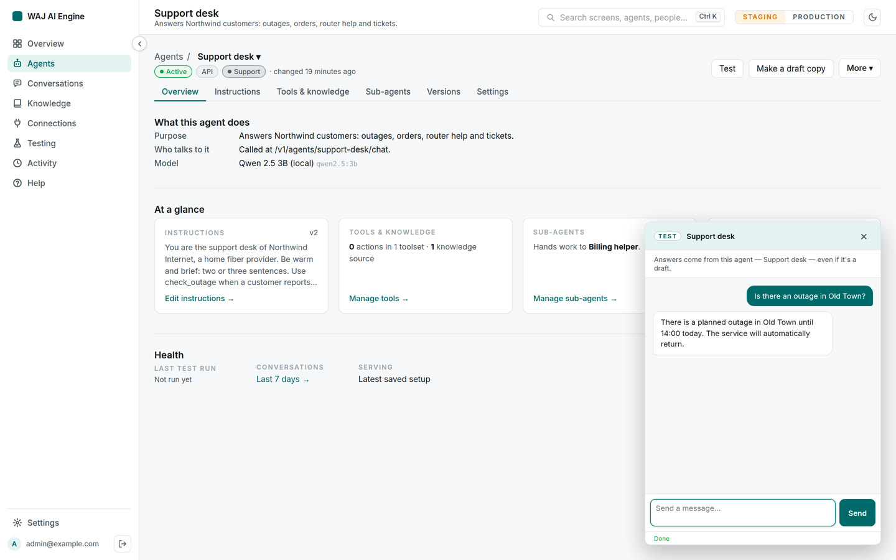

# Agents: agents that get things done

▶ **Full video with sound:** [engine-agents.mp4](media/engine-agents.mp4) (40 s)

Each agent has its own instructions, model, tools and knowledge, and can hand work to other agents. Start one from a template, tell it how to behave in plain words, connect it to your systems and test it right in the portal, before anyone else talks to it.

**Where:** Agents · **Guides:** [Create a new agent](07-new-agent.md), [Change what your agent says](02-instructions.md), [Test your agent](08-test-your-agent.md)

## How it works

### 1. See all your agents
The **Agents** list shows each agent's category, channel, model, what it can use and its status. Filter by status, channel or category.

### 2. Start from a template
Click **New agent**, pick a template (Blank is the plainest), then name the agent and choose its category. Its address is made from the name.

### 3. Tell it how to behave
On the **Instructions** tab, write what the agent should do in plain words, add a short note on what changed and save. Each save is a new version.

### 4. Give it tools and knowledge
On **Tools & knowledge**, add toolsets from your connected servers and attach knowledge bases. Here the Support desk uses Northwind systems and the Northwind help center.

### 5. Build a team
On **Sub-agents**, choose which specialists an agent can hand work to. The Support desk passes billing questions to the Billing helper.

### 6. Test it
Click **Test** and ask a real question. The agent checks the live system with its tools and answers.

## Good to know
- A new agent starts as a draft and serves nobody until you make it active.
- Categories only organise the list. They do not change how an agent runs.
- Test talks to the agent as it is now, draft or published.

## In this section
- [Find your agents and see what they do](01-your-agents.md): the Agents list and an agent's overview.
- [Change what your agent says](02-instructions.md): edit and save its instructions.
- [Choose what your agent can do and know](03-tools-and-knowledge.md): toolsets, actions and knowledge.
- [Let your agent hand off to other agents](04-sub-agents.md): specialists and hand-offs.
- [Set up how your agent sounds on calls](05-voice.md): voice settings.
- [Save a checkpoint and go back to it](06-versions.md): versions.
- [Create a new agent](07-new-agent.md): start from a template.
- [Test your agent](08-test-your-agent.md): talk to it before customers do.
- [Group your agents into categories](09-categories.md): Support, Sales, Internal tools and your own.
