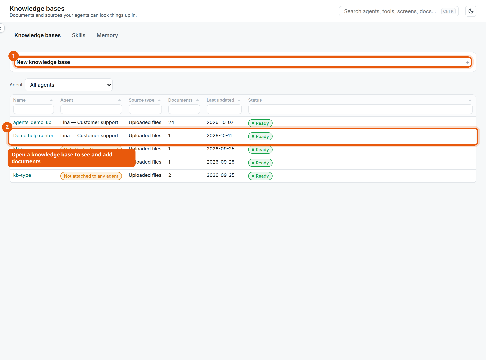
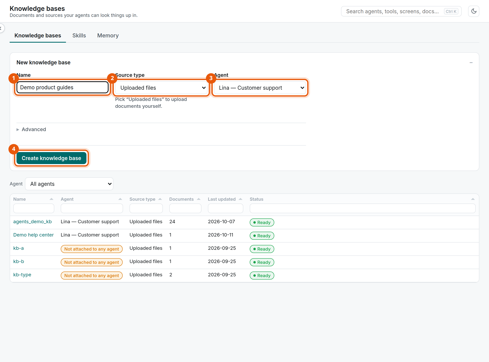
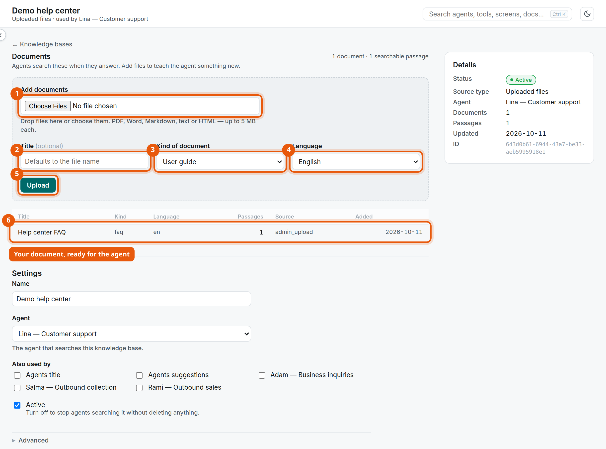

# Add documents to a knowledge base

A knowledge base is a set of documents an agent searches before it answers: price lists, policies, how-to guides, FAQs. Add a document and the agent can use it straight away.

<video src="../media/knowledge/knowledge-upload.mp4" controls muted playsinline width="100%"></video>
*Creating a "Demo help center" knowledge base for Lina and uploading a short FAQ.*

## Create a knowledge base

1. In the sidebar, click **Knowledge**. The **Knowledge bases** tab lists every knowledge base, the agent that uses it and how many documents it holds.
2. To look inside one, click its name.

To start a new one:

1. Click **New knowledge base** and type a **Name**, for example "Demo product guides".
2. Leave **Source type** on **Uploaded files** to upload documents yourself. The other types connect a folder or website, and your portal administrator usually sets those up.
3. Under **Agent**, pick the agent that should search it, for example **Lina — Customer support**.
4. Click **Create knowledge base**. The new knowledge base opens.

You can usually leave **Advanced** as it is.

## Upload documents

1. Under **Add documents**, click **Choose Files** (or drop files on the box). PDF, Word, Markdown, text and HTML files up to 5 MB each work.
2. Type a **Title**, or leave it blank to use the file name.
3. Pick the **Kind of document**, for example **FAQ** or **User guide**.
4. Pick the **Language** the document is written in.
5. Click **Upload**. A progress note appears while the file is read; the page refreshes when it's done, usually within a minute.
6. Your document appears in the list below, with the number of **Passages** the agent can search.

If the page says **Documents cannot be added or searched yet**, the engine has no embedding model set up. The message names the settings your portal administrator needs to add; **Upload** works once they are in place.

If it says **This knowledge base needs re-embedding**, the engine's embedding model was changed after these documents were added, and the agent can no longer find them reliably. Your portal administrator fixes this with the command shown in the message; nothing needs uploading again.

## Check what's in it

The list on a knowledge base page is everything the agent can find there. The numbers at the top show how many documents and searchable passages it holds. If a document shows 0 passages, upload it again.

Under **Settings** you can rename the knowledge base, change the agent that searches it, or tick **Also used by** to share it with more agents. Untick **Active** to stop agents searching it without deleting anything.

## Tips

- One topic per document works best: "Refunds and disputes" rather than one huge manual.
- Upload Arabic and English versions as separate documents, each with its own **Language**.
- After uploading, ask the agent about the new content in the test chat to make sure it finds it. See [Test your agent](../02-agents/08-test-your-agent.md).

**Related:** [Choose tools and knowledge for an agent](../02-agents/03-tools-and-knowledge.md) · [Skills](02-skills.md) · [What agents remember](03-memory.md)
