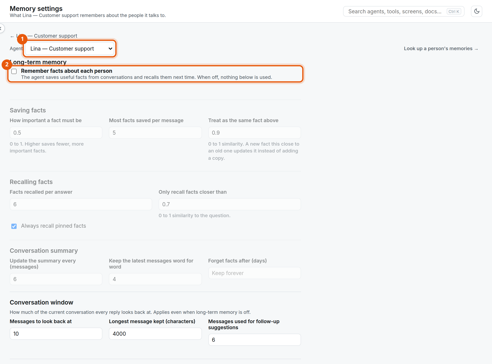
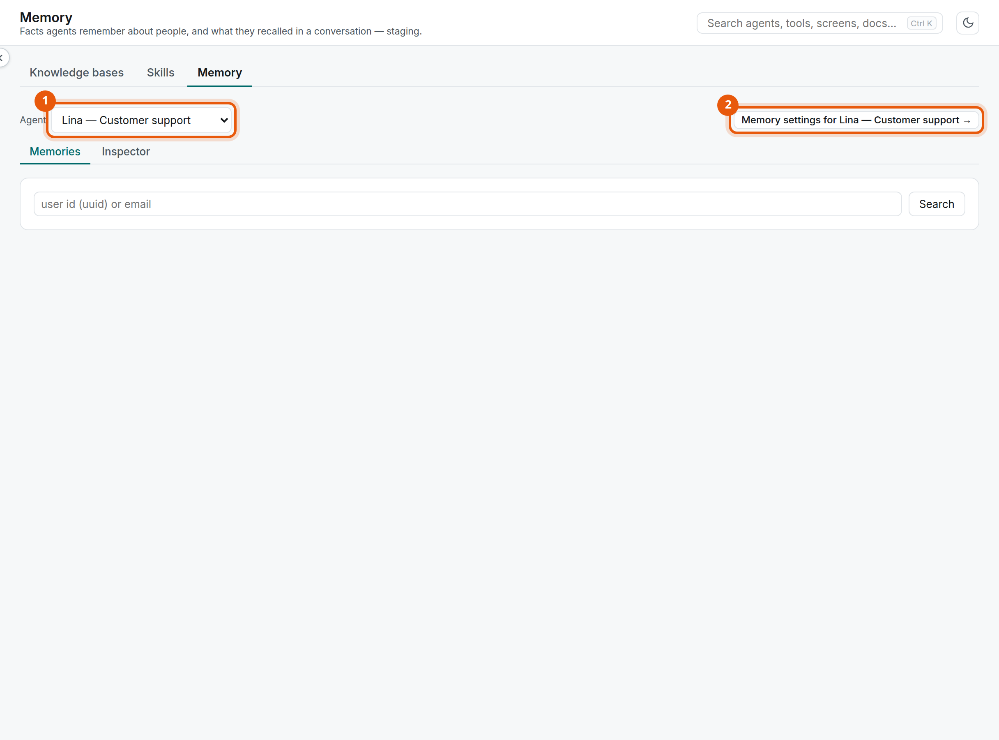

# What agents remember

Agents can remember useful facts about each person they talk to, such as a preferred language, and recall them next time. Memory is set per agent and is off unless you turn it on.

## Two kinds of memory

- **Conversation window**: how much of the *current* conversation the agent looks back at when it replies. This always applies.
- **Long-term memory**: facts the agent saves from conversations and recalls in later ones. This is optional.

## Change an agent's memory settings

1. In the sidebar, click **Knowledge**, then the **Memory** tab, then **Memory settings for …**. Pick the agent in the **Agent** list. Each agent you made yourself is listed by its own name and has its own settings; the page opens on the first of them.
2. Tick **Remember facts about each person** to turn long-term memory on. When it's off, nothing under **Saving facts**, **Recalling facts** or **Conversation summary** is used.
3. Adjust the numbers only if you have a reason to. The defaults suit most agents. For example, **How important a fact must be** set higher saves fewer facts, and **Forget facts after (days)** deletes old facts automatically.
4. Under **Conversation window**, **Messages to look back at** sets how many recent messages each reply considers.
5. Scroll down and click **Save memory settings**. The note next to the button names the agent and the environment the settings are saved to.

Saved settings apply to the agent in the test environment straight away. They reach customers when the agent's changes are published. See [Make your changes live](../07-publishing/01-publish-changes.md).

## Look up what an agent remembers

1. On the **Memory** tab, pick the agent.
2. **Memory settings for …** opens the settings described above.

Under **Memories**, search for a person to see the facts saved about them. **Inspector** shows what the agent recalled in one conversation.

Each agent keeps its own memories. What a person told one agent, for example your sales agent, is never recalled by another, such as your support agent, even when both were made from the same template.

If you used memory before agents kept their own, facts saved by hand back then may be listed under **Not assigned to an agent yet**. No agent recalls them. Click **Move to …** to give a fact to the agent you are viewing.

## Privacy

- Only turn long-term memory on when remembering people helps them, for example a support agent that should know a customer's plan.
- Use **Forget facts after (days)** so facts don't stay longer than needed.
- Voice agents usually keep long-term memory off: looking facts up adds a short delay before each spoken answer.
- The agent's instructions still decide what it may say. Memory never lets it skip identity checks.

**Related:** [Add documents to a knowledge base](01-knowledge-bases.md) · [Give an agent a skill](02-skills.md) · [Voice settings](../02-agents/05-voice.md)
