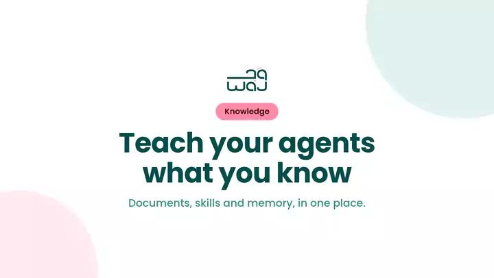
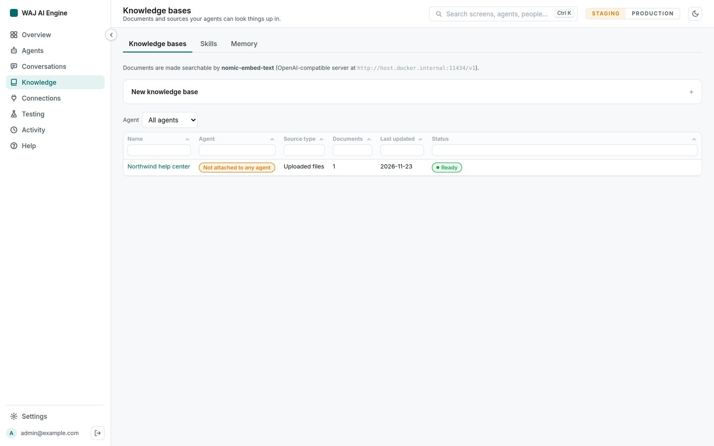
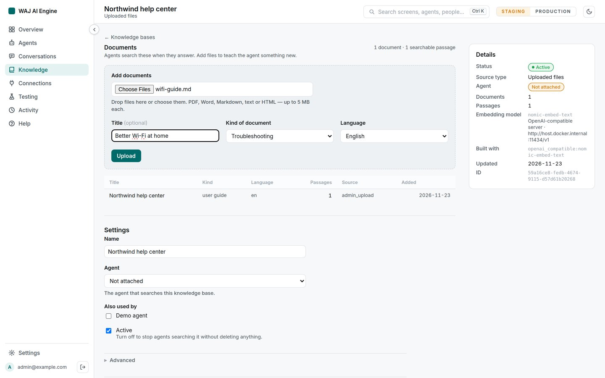
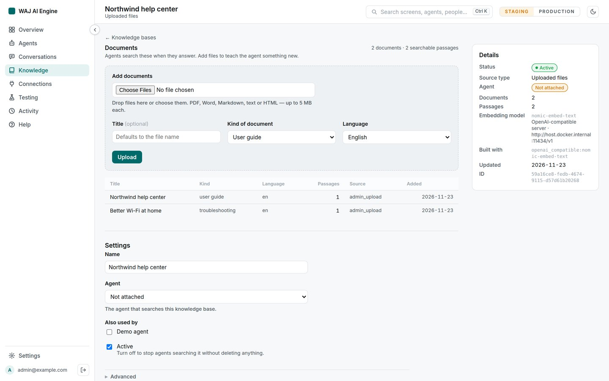
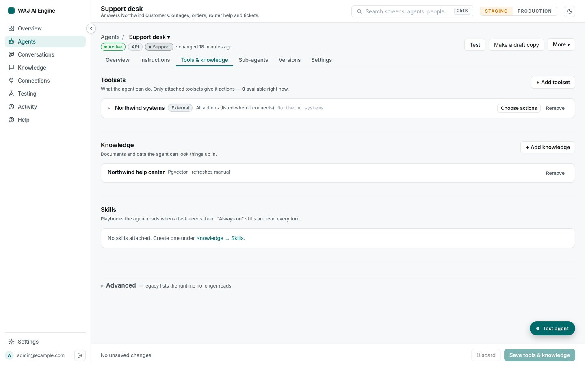
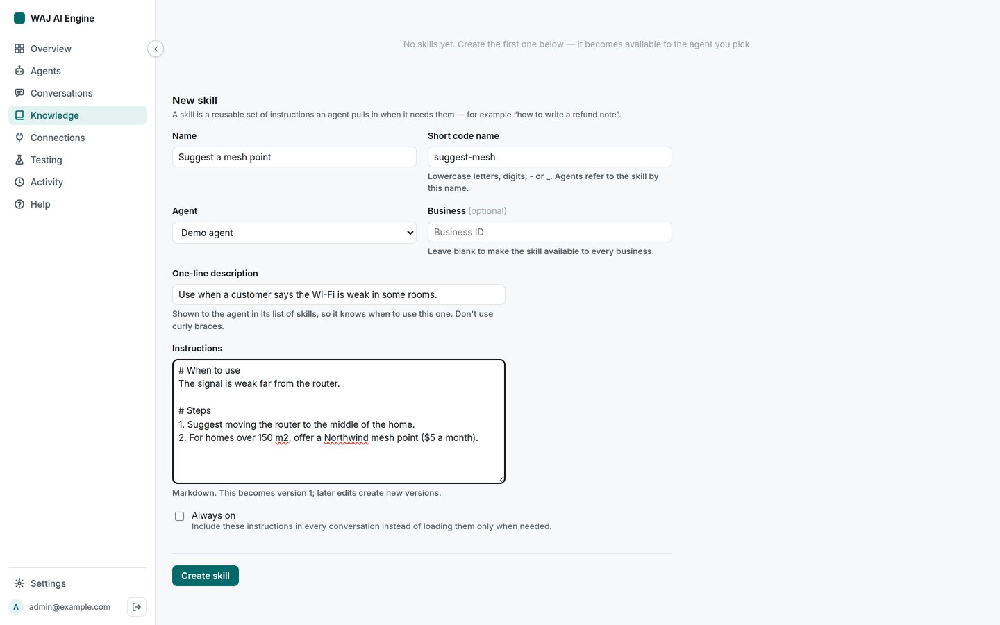
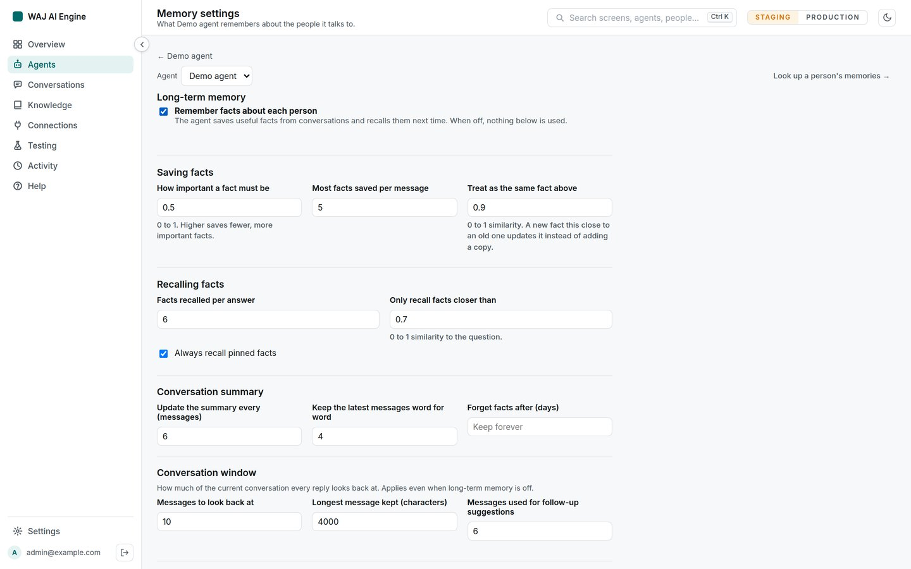

# Knowledge: teach your agents what you know

▶ **Full video with sound:** [engine-knowledge.mp4](media/engine-knowledge.mp4) (37 s)

Give your agents the facts, playbooks and memory they need. Upload documents to a knowledge base and the agent searches them before it answers. Skills hold short procedures the agent loads only when it needs them, and memory lets an agent remember each person it talks to.

**Where:** Knowledge (tabs Knowledge bases, Skills, Memory) · **Guides:** [Add documents to a knowledge base](01-knowledge-bases.md), [Give an agent a skill](02-skills.md), [What agents remember](03-memory.md)

## How it works

### 1. Open your knowledge bases
Click **Knowledge**. The **Knowledge bases** tab lists every knowledge base with its source type, document count and status. The line at the top names the embedding model that makes documents searchable.

### 2. Upload a document
Open a knowledge base. Under **Add documents**, choose a file (PDF, Word, Markdown, text or HTML, up to 5 MB), give it a **Title**, pick the **Kind of document** and the **Language**, and click **Upload**.

### 3. Check it is searchable
An **Ingestion in progress** note shows while the file is read. When it is done, the document appears in the list with its number of **Passages**, and the counts at the top go up.

### 4. Attach it to an agent
On the agent's **Tools & knowledge** tab, the **Knowledge** section lists the knowledge bases it searches. Use **+ Add knowledge** to attach another one.

### 5. Write a skill
On the **Skills** tab, give the skill a **Name**, a **Short code name**, the **Agent** that can use it, a **One-line description** and the **Instructions**, then click **Create skill**. Each saved edit becomes a new version.

### 6. Turn on memory
On the **Memory** tab, open **Memory settings for …**, pick the agent and tick **Remember facts about each person**. Then click **Save memory settings**.

## Good to know
- One topic per document works best, and Arabic and English versions go in as separate documents.
- If a document shows 0 passages after the upload has finished, upload it again.
- Leave **Always on** unticked on a skill so the agent loads it only when it is relevant.
- Long-term memory is off unless you turn it on. Saved memory settings apply in the test environment straight away and reach customers when the agent's changes are published.

## In this section
- [Add documents to a knowledge base](01-knowledge-bases.md): create a knowledge base, upload documents and check what is in it.
- [Give an agent a skill](02-skills.md): write reusable instructions an agent loads when it needs them.
- [What agents remember](03-memory.md): the conversation window, long-term memory and how to look up what an agent remembers.
