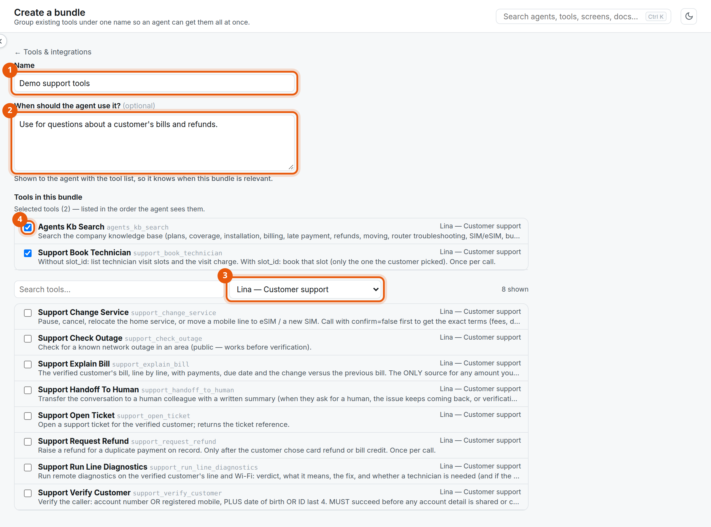

# Connect tools and integrations

Tools are the actions an agent can take, such as checking an outage or booking a technician. They come grouped in servers: built-in ones, bundles you put together, and external servers you connect from your own systems.

In the sidebar, click **Connections**. The **Tools & integrations** tab shows:

- **Servers**: each one with its type, how many tools it offers and which agents use it.
- **Tool catalog**: every tool. Open one to edit its name, its description and its usage guidance, the notes that tell the agent when to use it. An external server's tools are listed under its name as the server reports them, once the engine has reached it (click **Test connection** on the server if they are missing). Their names and descriptions come from the server, so they can't be edited here. Pick an agent in the agent filter to see only its tools: the tools made for it, and every tool of a server attached to it, an external server included.

Numbers in the picture: (1) **Connect server**, (2) **Create bundle**, (3) search the tool catalog.

## Connect a server

Use this to give your agents tools from one of your own systems, for example a booking system. The system must offer an MCP server (a standard way for AI agents to call tools). Your IT team will know the address.

1. Click **Connect server** and type a **Name**, for example "Demo booking system".
2. Type the **Server address (URL)**, starting with `https://`.
3. If the server needs a token, don't paste the token itself. Enter the **name** of the secret that holds it; ask your portal administrator to add the secret for you. Leave **Access token** blank if no token is needed.
4. Click **Discover tools**. The portal asks the server for its tools and lists them. Nothing is saved yet. If it can't connect, check the address and token.
5. Under **Tools to allow**, untick any tools the agent shouldn't use. Blank means every tool.
6. Click **Connect server**.

You can usually leave **Advanced** as it is. Then attach the server to an agent on the agent's **Tools** tab. See [Choose tools and knowledge for an agent](../02-agents/03-tools-and-knowledge.md).

## Create a bundle

A bundle groups existing tools under one name, so you can give an agent a whole set at once.

1. Click **Create bundle**. Type a **Name**, for example "Demo support tools".
2. Under **When should the agent use it?**, write one sentence, for example "Use for questions about a customer's bills and refunds."
3. Use the agent filter (or **Search tools…**) to find the tools you want.
4. Tick each tool. Ticked tools move to the top, in the order the agent sees them.
5. Scroll down and click **Create bundle**.

## Good to know

- Tools marked as changing data (for example booking or refunding) really act in a live system. Test with test accounts.
- Good usage guidance is the easiest way to stop an agent using the wrong tool.

**Related:** [Channels](02-channels.md) · [Choose tools and knowledge for an agent](../02-agents/03-tools-and-knowledge.md) · [Test your agent](../02-agents/08-test-your-agent.md)
