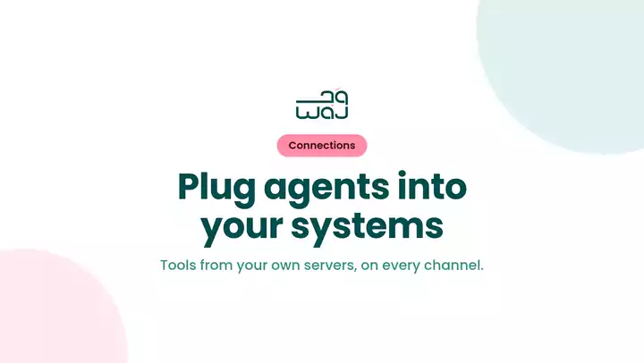
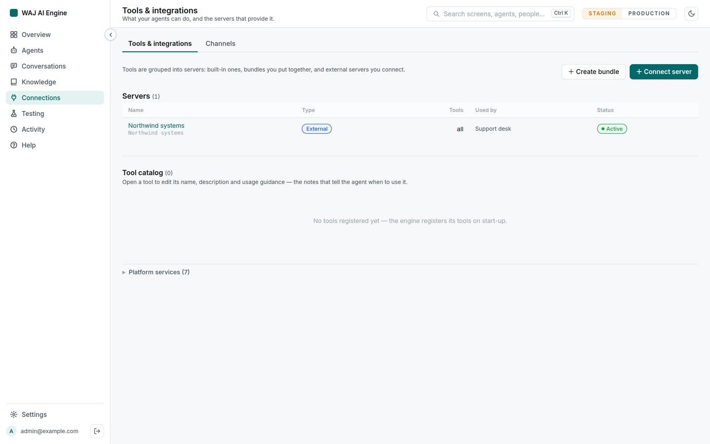
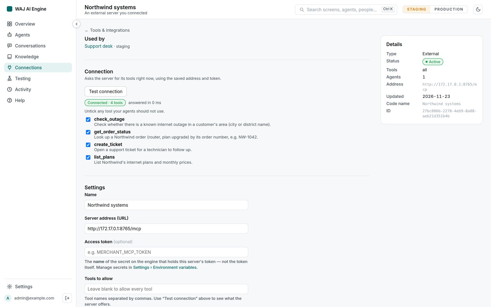
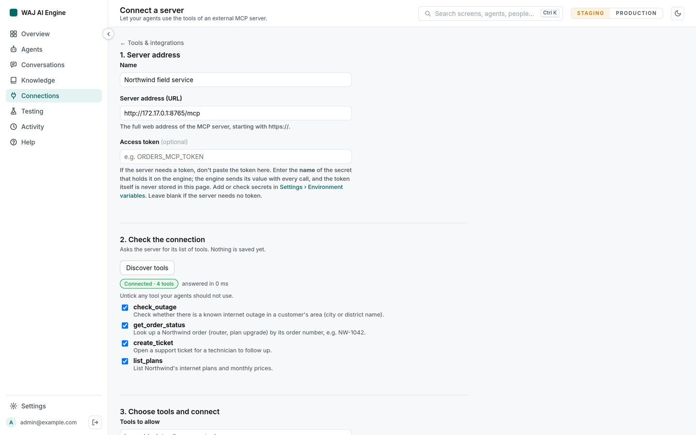
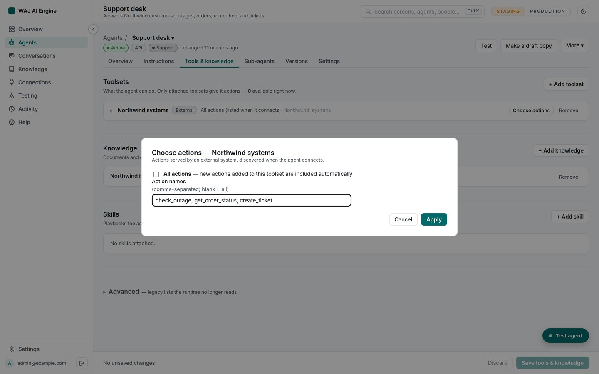
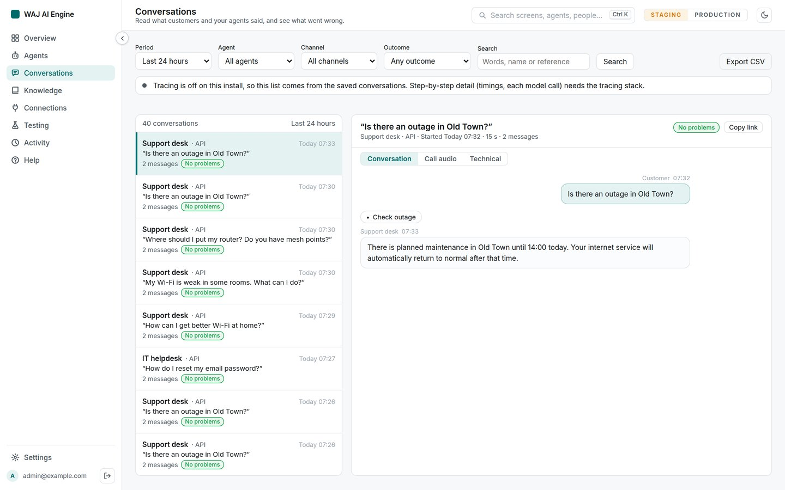
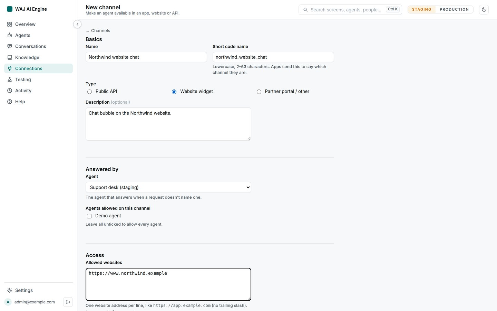

# Connections: plug agents into your systems

▶ **Full video with sound:** [engine-connections.mp4](media/engine-connections.mp4) (36 s)

Tools are the actions an agent can take, like checking an outage or opening a ticket. Connect a server from your own systems, choose which actions each agent may use, and put your agents on the channels where customers reach you.

**Where:** Connections (tabs Tools & integrations, Channels) · **Guides:** [Connect tools and integrations](01-tools-and-integrations.md), [Channels](02-channels.md)

## How it works

### 1. See your servers
Click **Connections**. The **Tools & integrations** tab lists each server with its type, how many tools it offers, which agents use it and its status.

### 2. Test a connection
Open a server and click **Test connection**. The portal asks the server for its tools right now and lists each one with its description.

### 3. Connect a new server
Click **Connect server**, type a **Name** and the **Server address (URL)**, and enter the name of the secret that holds its token if it needs one. Click **Discover tools** to see what it offers before anything is saved, untick tools the agent should not use, then click **Connect server**.

### 4. Choose what an agent may do
On the agent's **Tools & knowledge** tab, click **Choose actions** next to a toolset. Keep **All actions**, or untick it and list the action names the agent may use, then click **Apply**.

### 5. See the tools at work
Ask the agent something that needs a tool. In **Conversations**, the answer shows the tool it used, here **Check outage** before it tells the customer about planned maintenance.

### 6. Add a channel
On the **Channels** tab, click **New channel**. Type a **Name** and **Short code name**, pick the **Type** (for example **Website widget**), choose the agent under **Answered by**, add each **Allowed website**, then click **Create channel**.

## Good to know
- Enter the name of the secret that holds a server's token, never the token itself.
- **Discover tools** saves nothing, so you can check a server before you connect it.
- Tools that change data really act in a live system. Test with test accounts.
- A bundle groups existing tools under one name, so you can give an agent a whole set at once.
- Give a channel's short code name to your developers; they use it to connect the website or app.

## In this section
- [Connect tools and integrations](01-tools-and-integrations.md): servers, the tool catalog, connecting a server and creating a bundle.
- [Channels](02-channels.md): where customers reach your agents and how to add a channel.
