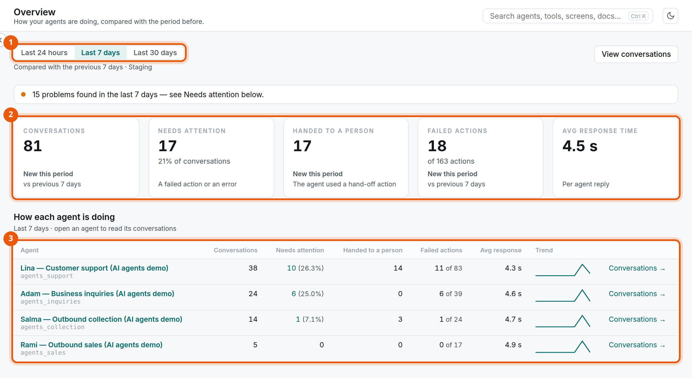
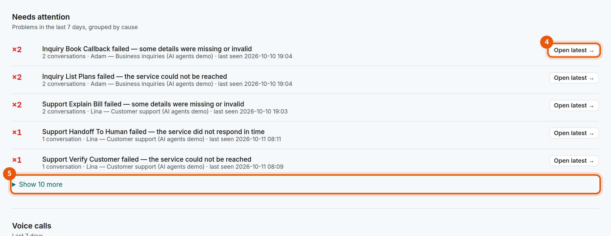

# Read the Overview

The Overview tells you in one glance how your agents are doing and what needs your attention. Open it by clicking **Overview** in the sidebar.

## Read it from top to bottom

1. **Pick a period**: **Last 24 hours**, **Last 7 days** or **Last 30 days**. Every number on the page compares this period with the one before it, for example this week against last week. A line under the picker says so.
2. **Read the tiles**:
   - **Conversations**: how many conversations your agents had.
   - **Needs attention**: conversations where an action failed or an error happened, with their share of all conversations. This is the number to watch.
   - **Handed to a person**: how often an agent passed the customer to a member of your team.
   - **Failed actions**: actions that didn't work, out of all actions agents tried (for example "11 of 83").
   - **Avg response time**: how long an agent typically takes to reply.

   **New this period** means there's nothing to compare with yet.
3. **How each agent is doing** puts the same numbers side by side for each agent, with a small trend line. Click an agent's name to open it, or **Conversations →** to read its conversations.

A short line above the tiles sums things up, such as "All agents running normally" or "15 problems found in the last 7 days".

## Act on problems

**Needs attention** groups problems by cause, with the most frequent first. Each line says which action failed and why in plain words, for example "the service could not be reached" or "some details were missing or invalid", plus how many conversations it touched and when it last happened.

4. Click **Open latest →** to read the most recent conversation with that problem.
5. Click **Show more** to see the rest of the list.

What to do next depends on the cause:

- **Could not be reached** or **did not respond in time**: the system behind that action was down or slow. If it keeps happening, tell your portal administrator.
- **Details were missing or invalid**: the agent asked for, or passed on, the wrong information. Read the conversation, then adjust the [instructions](../02-agents/02-instructions.md).

## More on this page

- **Voice calls** shows calls, minutes used, today's use against the [daily voice allowance](../08-team-and-settings/03-voice-budgets.md), how fast the agent starts talking, and how often callers talked over it.
- **Technical details** at the bottom holds charts for engineers. You can usually leave it closed.
- **View conversations** at the top right opens the full list.

If a tile or table says **Unavailable right now**, the numbers couldn't be loaded. That doesn't mean zero. Try again in a few minutes.

**Related:** [Review a conversation](02-review-a-conversation.md) · [Your agents](../02-agents/01-your-agents.md) · [FAQ](../09-reference/02-faq.md)
