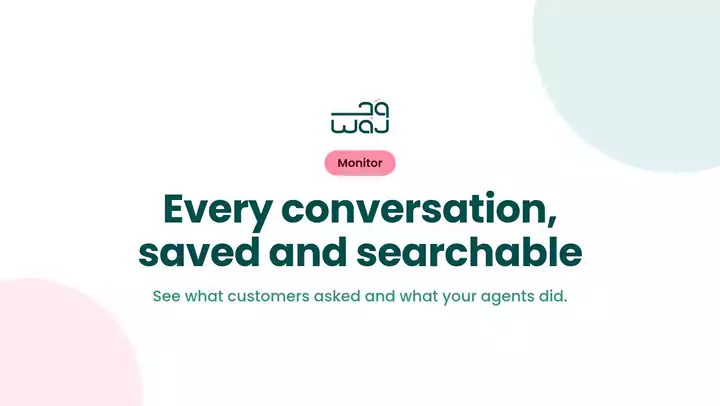
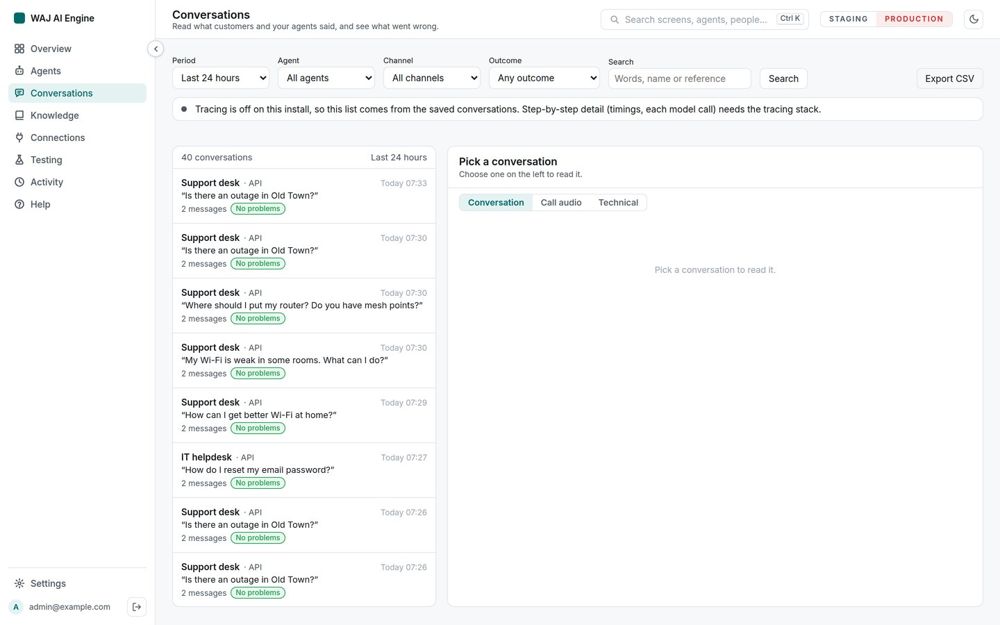
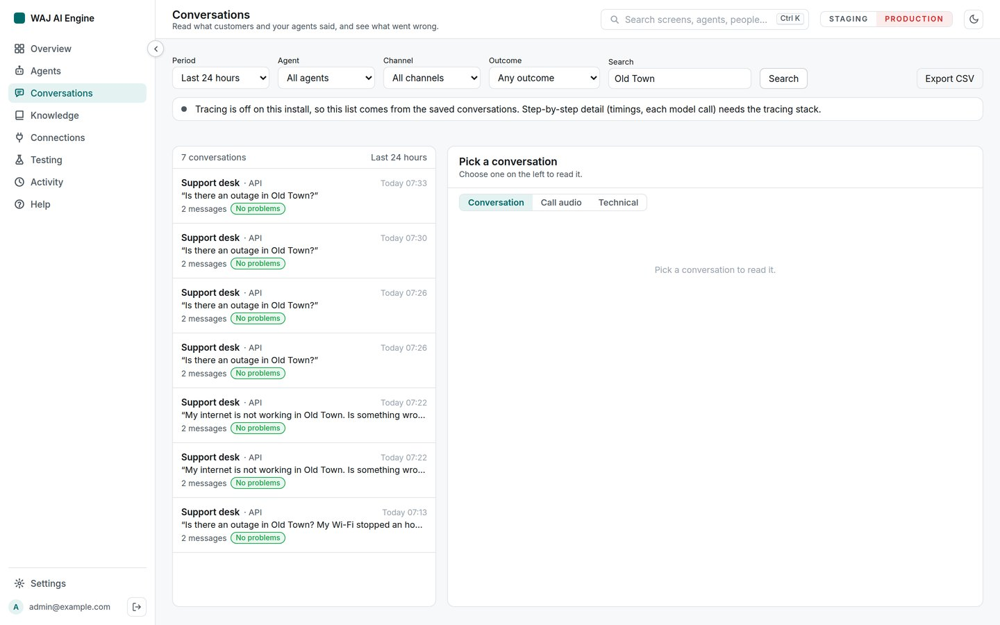
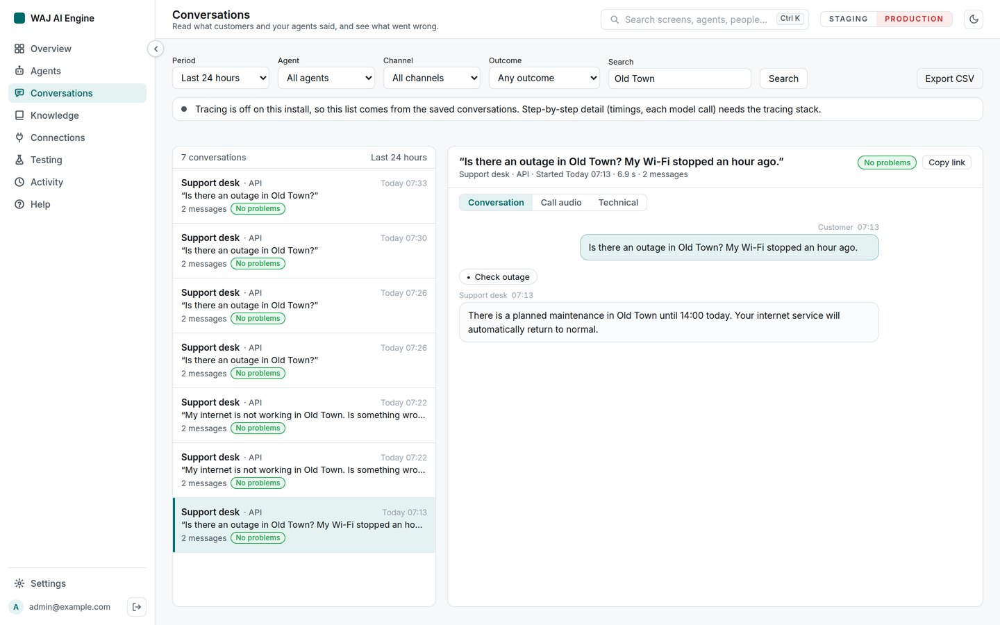
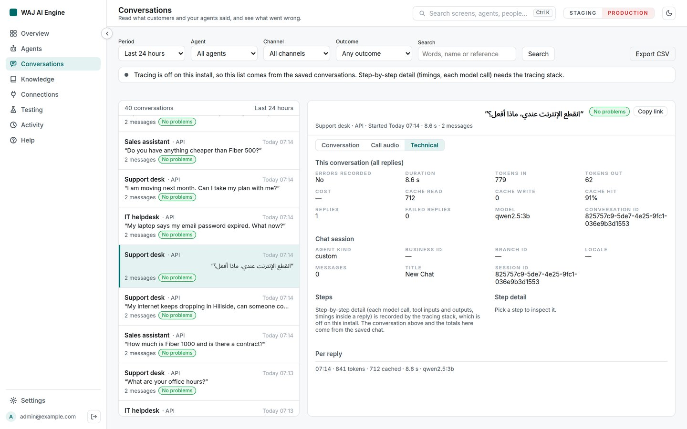
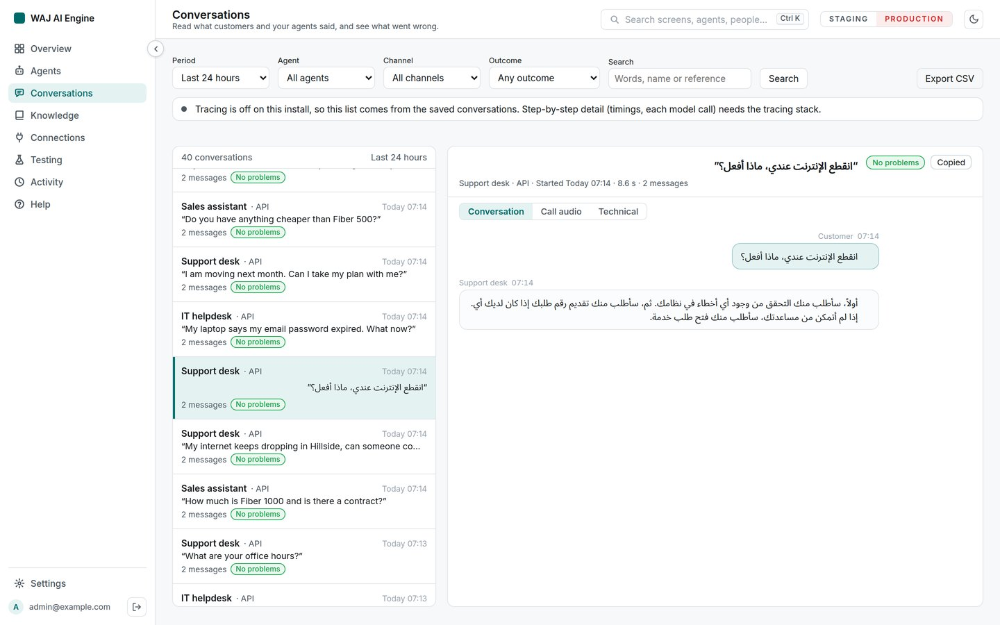

# Monitor: read every conversation your agents have

▶ **Full video with sound:** [engine-monitor.mp4](media/engine-monitor.mp4) (35 s)

Every conversation your agents have is saved, so you can read exactly what a customer asked and what the agent answered. Search the list, open a conversation to see the actions the agent took, and share a link with your team.

**Where:** **Conversations** in the sidebar (and **Overview** for the summary) · **Guides:** [Read the Overview](01-overview.md), [Review a conversation](02-review-a-conversation.md)

## How it works

### 1. See every conversation
The list shows each conversation with the agent, when it started, the customer's first message, how many messages it has and a coloured outcome label.

### 2. Find the one you need
Narrow the list with **Period**, **Agent**, **Channel** and **Outcome**, or type words, a name or a reference and click **Search**.

### 3. Read it, actions included
Click a conversation to read it like a chat. Small labels between messages show each action the agent took, such as **Check outage**.

### 4. Check the numbers
Conversations in any language are saved the same way. The **Technical** tab shows totals for the conversation: duration, tokens in and out, cache hits and the model that answered.

### 5. Share it
Click **Copy link** to copy a link to the conversation for anyone on your team who can sign in. **Export CSV** downloads the list as a spreadsheet.

## Good to know
- Conversations are always saved, even when the tracing stack is off. Without tracing, the Overview counts conversations and the other tiles read **Needs tracing**.
- With tracing off, action labels show the action's name without ✓ or ✕, and **Technical** shows totals instead of step-by-step timing.
- For calls, the **Call audio** tab plays the recording.
- When you find a conversation that went wrong, turn it into a test case. See [Test suites](../06-testing/06-test-suites.md).

## In this section
- [Read the Overview](01-overview.md): how your agents are doing, and the problems that need attention.
- [Review a conversation](02-review-a-conversation.md): find a conversation, read it, spot what went wrong and share it.
