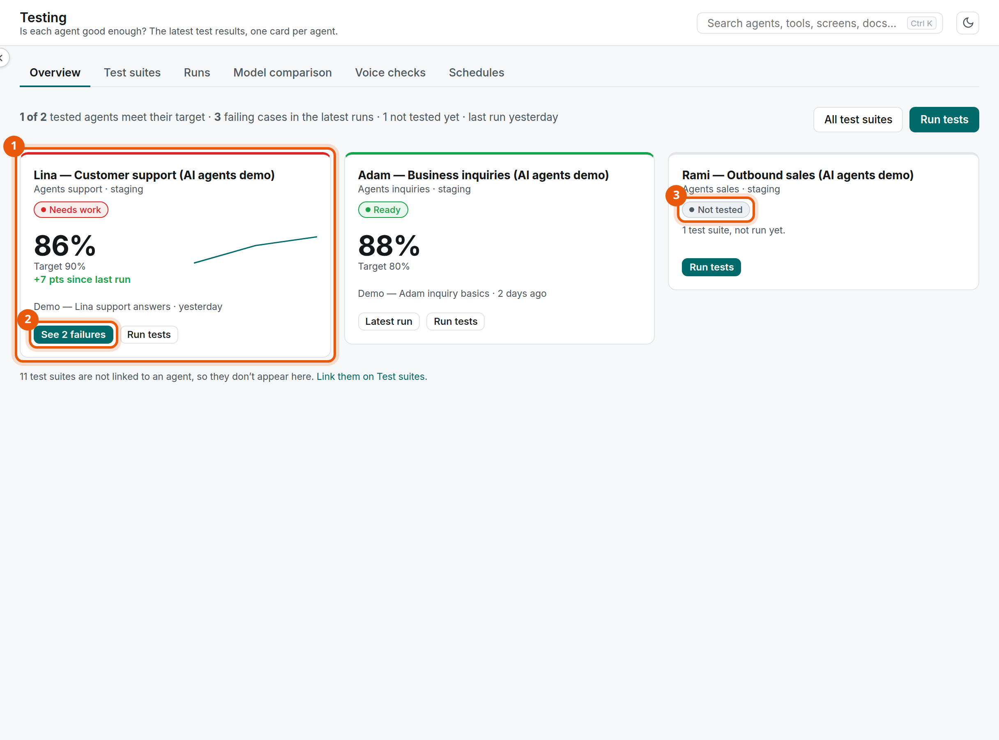

# Is each agent good enough?

The Testing overview answers one question per agent: does it pass its tests? Check it before and after you change an agent.

In the sidebar, click **Testing**. The **Overview** tab shows a one-line summary at the top, then one card per agent that has a test suite.

## Read a card

1. Each card shows the agent's latest score against its **target**, the change since the last run, and a small line of recent scores. The label at the top is the verdict:
   - **Ready**: every test suite for this agent meets its target.
   - **Needs work**: at least one suite is below its target. In the picture, Lina scored 86% against a target of 90%.
   - **Not tested**: the agent has a test suite that hasn't run yet.
2. **See 2 failures** opens the latest run with the failed cases first. See [Run a test and read the result](02-run-a-test.md).
3. An agent marked **Not tested** needs a first run: click **Run tests** on its card.

Below the cards, a note tells you if some test suites aren't linked to an agent. Those don't appear on any card.

## The tabs

| Tab | What it's for |
|---|---|
| **Test suites** | Your sets of test cases. See [Test suites and schedules](06-test-suites.md). |
| **Runs** | Every test run, newest first. Tick two to compare them. See [Compare results](03-compare-results.md). |
| **Model comparison** | Run the same tests on different AI models and get a recommendation. See [Compare models](04-model-comparison.md). |
| **Voice checks** | Scripted phone calls for voice agents. See [Voice checks](05-voice-checks.md). |
| **Schedules** | Grade real conversations automatically every day or week. |

## A good routine

1. Before changing an agent, make sure its card is up to date (run its tests if the last run is old).
2. Make your change and run the tests again.
3. If the score dropped, or a case broke, fix it before publishing. See [Make your changes live](../07-publishing/01-publish-changes.md).

**Related:** [Run a test and read the result](02-run-a-test.md) · [Test your agent](../02-agents/08-test-your-agent.md) · [Glossary](../09-reference/01-glossary.md)
