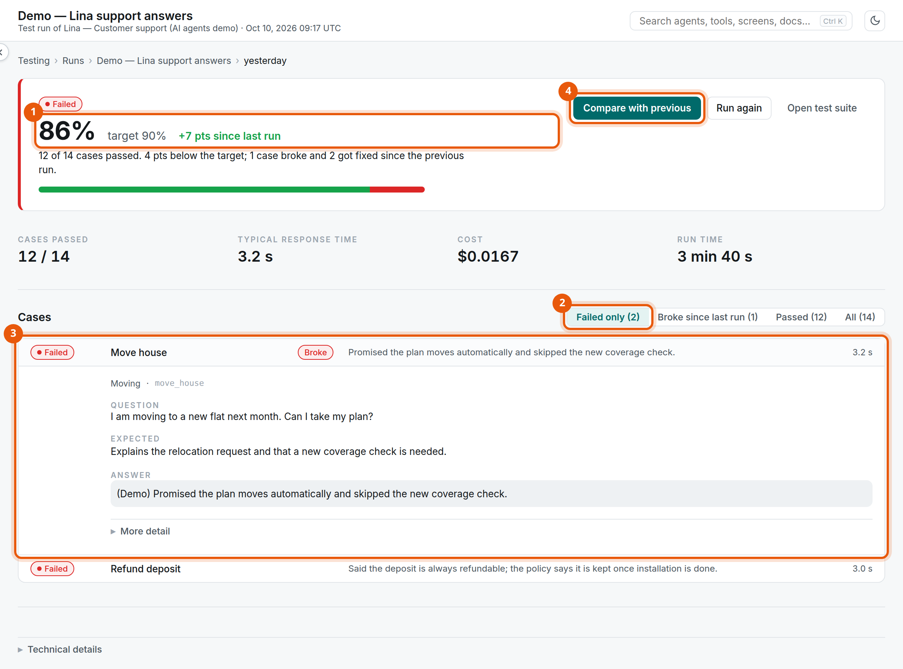

# Run a test and read the result

A test run plays every case in a test suite against the agent and grades each answer. You get a score, a verdict against the target, and the failed cases with the reason they failed.

<video src="../media/testing/run-a-test.mp4" controls muted playsinline width="100%"></video>
*Running Lina's test suite, opening a failed case and comparing with the previous run. A real run takes a few minutes; the video skips the wait.*

## Start a run

1. On the Testing **Overview**, click **Run tests** on the agent's card (or **Run tests** at the top right).
2. Under **What to test**, leave **A test suite** selected.
3. Check the **Agent**, then pick the **Test suite**. Only suites linked to that agent are listed.
4. Leave **Advanced** as it is (and **Business**, where your portal shows one, on its default).
5. Click **Start run**. The run page opens and fills in as cases finish. You can leave the page; the run carries on.

## Read the result

1. The top line is the verdict: **Failed** or **Passed**, the score (the share of cases that passed), the **target**, and the change since the last run. The sentence underneath says it in words, for example "12 of 14 cases passed. 4 pts below the target; 1 case broke and 2 got fixed since the previous run."
2. **Cases** opens on **Failed only**. Use **Broke since last run** to see cases that passed before and fail now; those are usually caused by your last change.
3. Click a case to open it: the **Question**, the **Expected** answer and the agent's **Answer**, with the reason it failed on the row. In the picture, Lina promised a plan moves automatically and skipped the coverage check.
4. **Compare with previous** puts this run next to the one before. See [Compare results](03-compare-results.md).

The row of numbers shows cases passed, typical response time, cost and how long the run took.

A case marked **Not judged** could not be graded: no judge model is set (or the one set can't be used), and the answer doesn't contain the expected words. It doesn't count towards the score. The case says why; pick a **Judge model** in the suite's settings, or give the case expected words.

If you try another **Model** under **Advanced** and the suite has no judge model, the run doesn't start and a page tells you what to set, with a link back to the form.

## What to do with a failure

- If the agent was wrong, fix its instructions, knowledge or tools, then click **Run again**. See [Change what your agent says](../02-agents/02-instructions.md).
- If the expected answer is out of date, fix the case in the test suite. See [Test suites and schedules](06-test-suites.md).
- If a run shows errors on every case, the agent couldn't be reached. Try again later or tell your portal administrator.

**Related:** [Is each agent good enough?](01-testing-overview.md) · [Compare results](03-compare-results.md) · [FAQ](../09-reference/02-faq.md)
