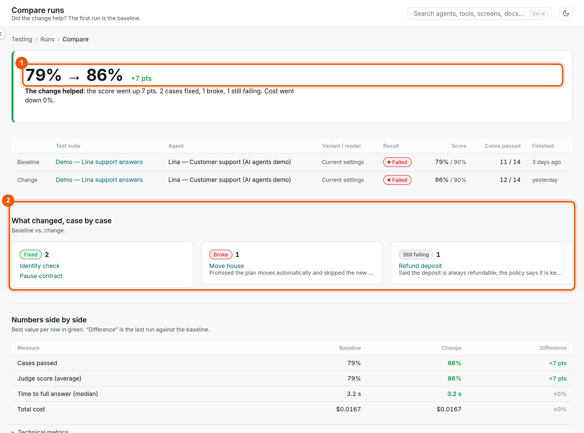

# Compare results

Comparing two runs of the same test suite shows whether a change helped: which cases got fixed, which broke, and which still fail.

## Open a comparison

- From a run: click **Compare with previous**. The earlier run is the **Baseline**, this one is the **Change**.
- From the **Runs** tab: tick two or more runs and click **Compare selected**.

## Read it

1. The headline shows the score before and after, for example **79% → 86%  +7 pts**, and a sentence with the verdict: "The change helped: the score went up 7 pts. 2 cases fixed, 1 broke, 1 still failing."
2. **What changed, case by case** groups the cases:
   - **Fixed**: failed before, pass now.
   - **Broke**: passed before, fail now. Look at these first: they are the side effects of your change.
   - **Still failing**: failed both times. Your change didn't reach them.

   Click a case name to open it in the run.

Below that, **Numbers side by side** lines up the score, response time and cost. The best value in each row is green.

## Tips

- Compare runs of the **same** test suite. Different suites have different cases, so the numbers don't line up.
- A higher score with one case broken may still be a step back if that case matters most (for example, identity checks). Fix it before you publish.
- To compare AI models rather than your own changes, use a model comparison. See [Compare models](04-model-comparison.md).

**Related:** [Run a test and read the result](02-run-a-test.md) · [Versions](../02-agents/06-versions.md) · [Make your changes live](../07-publishing/01-publish-changes.md)
