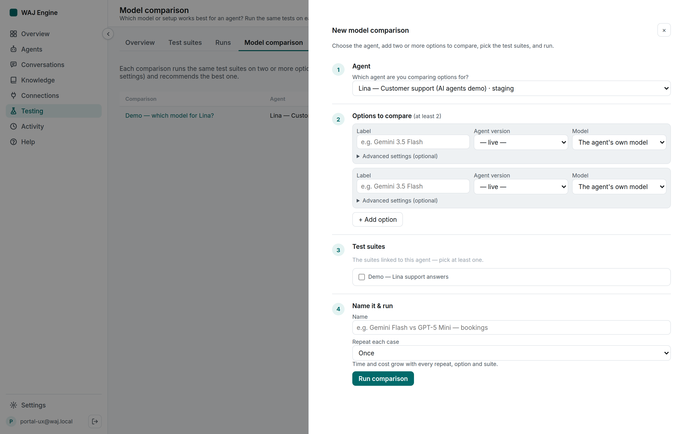
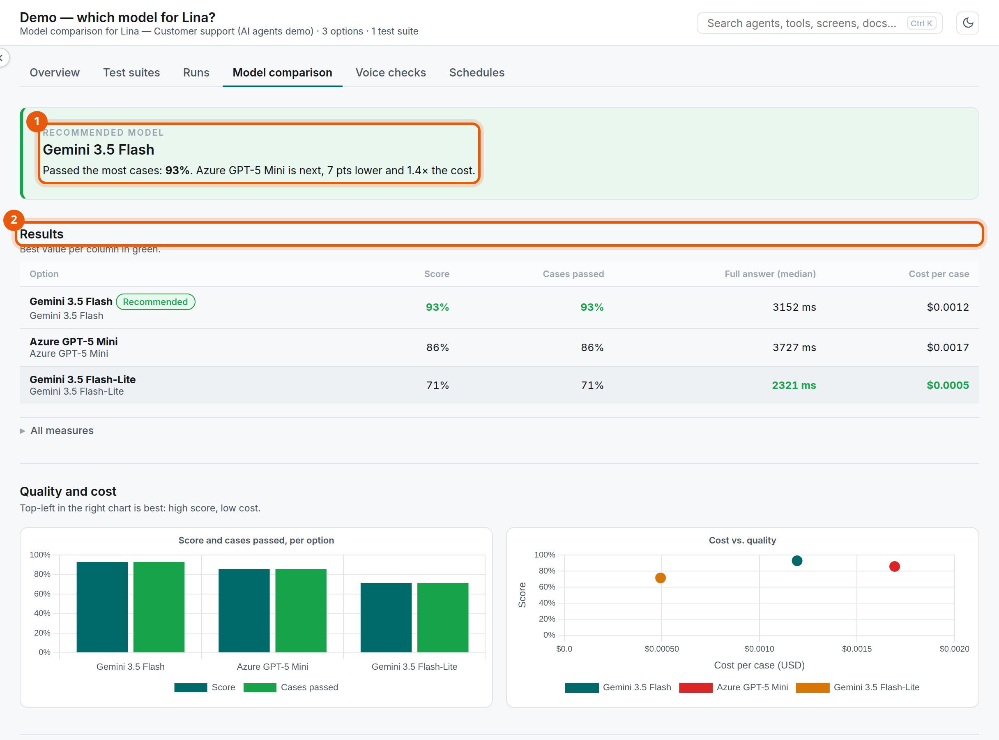

# Compare models

A model comparison runs the same test suites on two or more options, usually different AI models, and recommends the best one. Use it before switching an agent to a new model.

## Start a comparison

1. On **Testing**, open the **Model comparison** tab and click **New comparison**. Under **Agent**, pick the agent, for example Lina.
2. Under **Options to compare**, fill in at least two options. For each one, type a **Label** and pick a **Model**. Keep **Agent version** on **— live —** to test the agent as it is now. Click **+ Add option** for more. You can usually leave **Advanced settings** as they are.
3. Under **Test suites**, tick at least one suite.
4. Type a **Name**, leave **Repeat each case** on **Once**, and click **Run comparison**.

Each option runs every case, so a comparison takes longer and costs more than a single run. Repeating each case makes the result more reliable, and slower.

## Read the result

1. **Recommended model** names the winner and why, for example "Passed the most cases: 93%. Azure GPT-5 Mini is next, 7 pts lower and 1.4× the cost."
2. **Results** lists every option with its score, cases passed, typical full-answer time and cost per case. The best value in each column is green.

**Quality and cost** charts the same numbers. In the right-hand chart, top-left is best: a high score at a low cost.

## Deciding

- The recommendation favours passing the most cases. If two options are close, the cheaper or faster one may be the better choice.
- Open the runs behind each option (listed further down the page) to see which cases each model failed.
- Changing an agent's model is a change like any other: ask your portal administrator or follow [Make your changes live](../07-publishing/01-publish-changes.md).

**Related:** [Compare results](03-compare-results.md) · [Run a test and read the result](02-run-a-test.md) · [Glossary](../09-reference/01-glossary.md)
