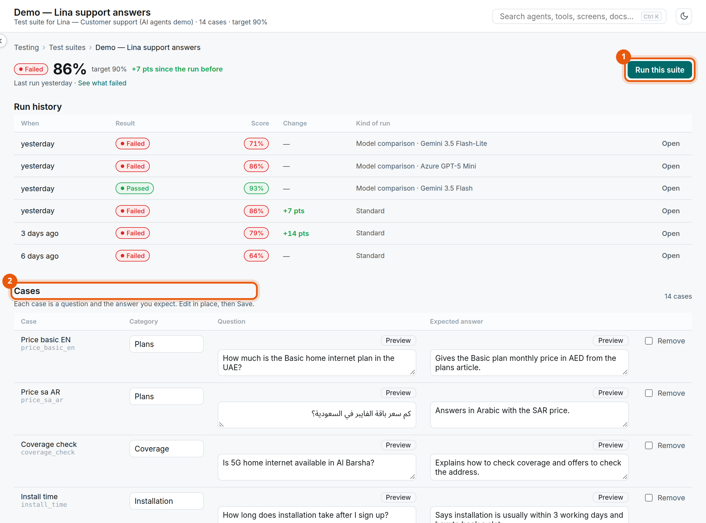
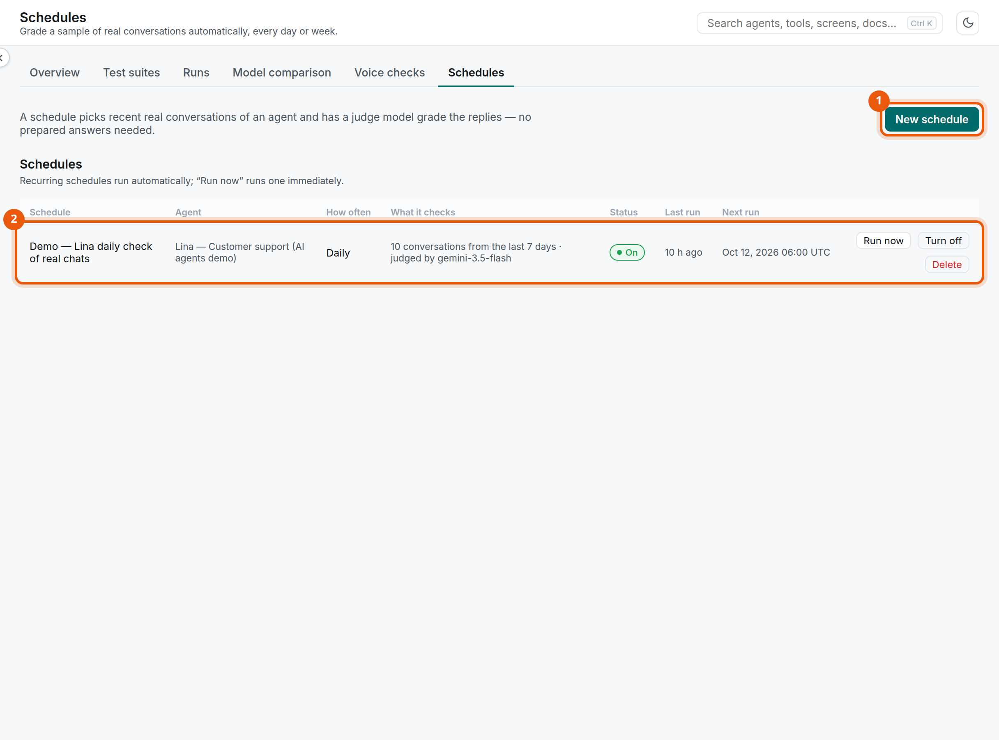

# Test suites and schedules

A test suite is a set of cases for one agent: each case is a question and the answer you expect. A schedule grades real conversations automatically, without prepared answers.

## Create a test suite

1. On **Testing**, open the **Test suites** tab and click **Create test suite**.
2. Type a **Name**, for example "Demo — Lina support answers", and pick the **Agent**. **Agent type** fills in by itself.
3. Set the **Target score**: a run passes when its score reaches it. 80–90% is typical.
4. Pick a **Judge model** so each answer is graded against the expected answer. Without one, only expected words are checked.
5. Click **Create suite**, then open the suite to add cases.

## Add and edit cases

Open a suite from the **Test suites** tab. The top shows the latest result and the **Run history**.

1. **Run this suite** starts a run. See [Run a test and read the result](02-run-a-test.md).
2. Under **Cases**, each row has a **Category**, the **Question** the customer asks and the **Expected answer**. Edit them in place, then click **Save**. Tick **Remove** to delete a case.

Writing good cases:

- Describe what a good answer must do, not the exact words: "Says installation is usually within 3 working days and how to book a slot."
- Include the cases that matter most: identity checks, refunds, hand-off to a person.
- Add a case each time you find a real conversation that went wrong, so it can't come back unnoticed.
- Write Arabic questions as separate cases.

## Schedules

1. On the **Schedules** tab, click **New schedule**. Pick the agent and how often it runs; the judge grades a sample of that agent's recent real conversations against your expectations, for example "Answers follow the policies and never share account details before verification."
2. Each schedule shows how often it runs, what it checks, when it last ran and when it runs next. **Run now** runs it immediately, **Turn off** pauses it.

**Related:** [Is each agent good enough?](01-testing-overview.md) · [Compare results](03-compare-results.md) · [Review a conversation](../05-monitor/02-review-a-conversation.md)
