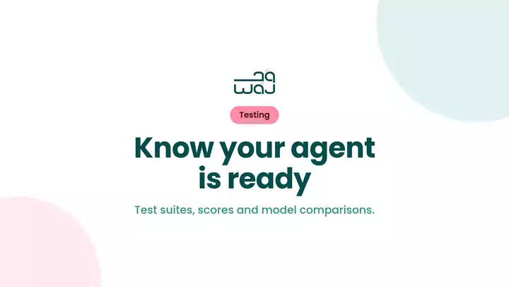
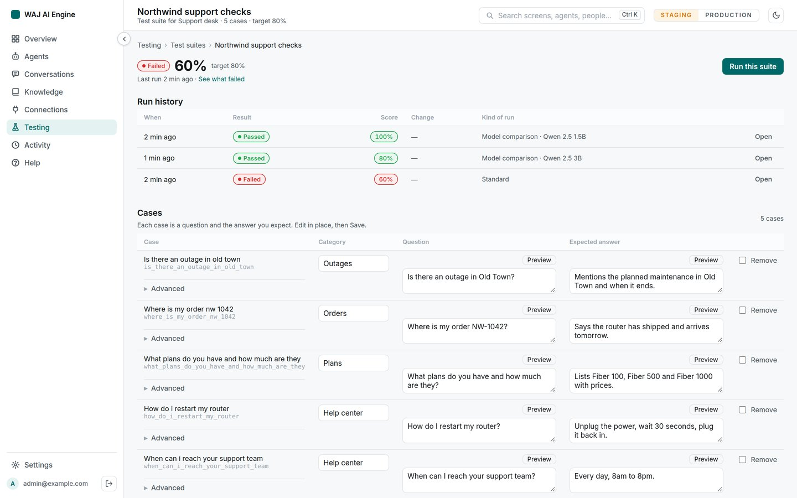
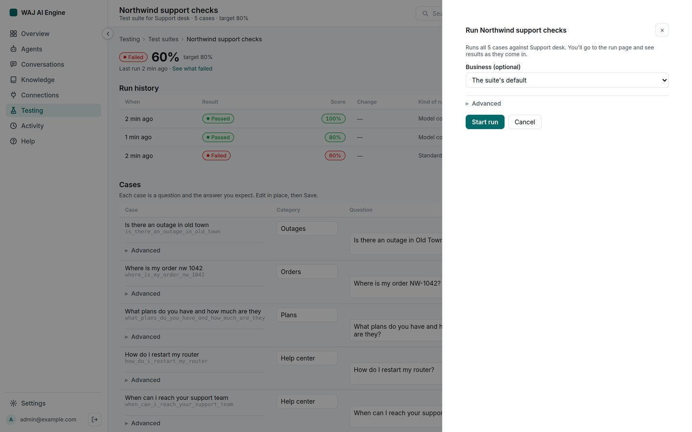
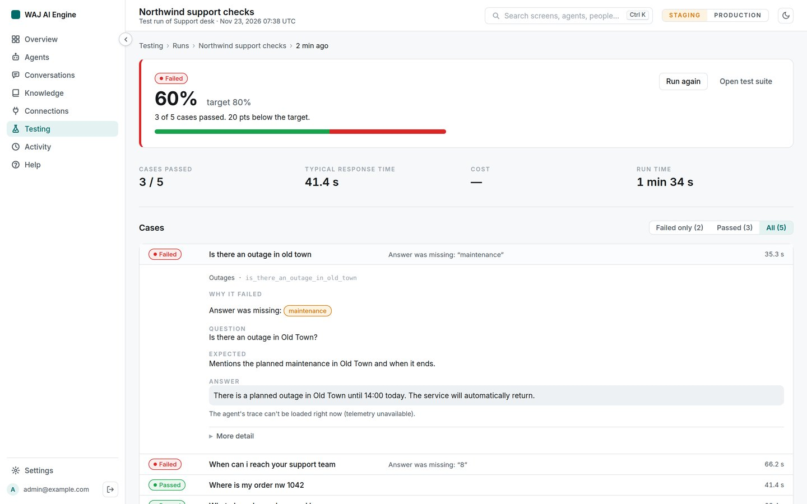
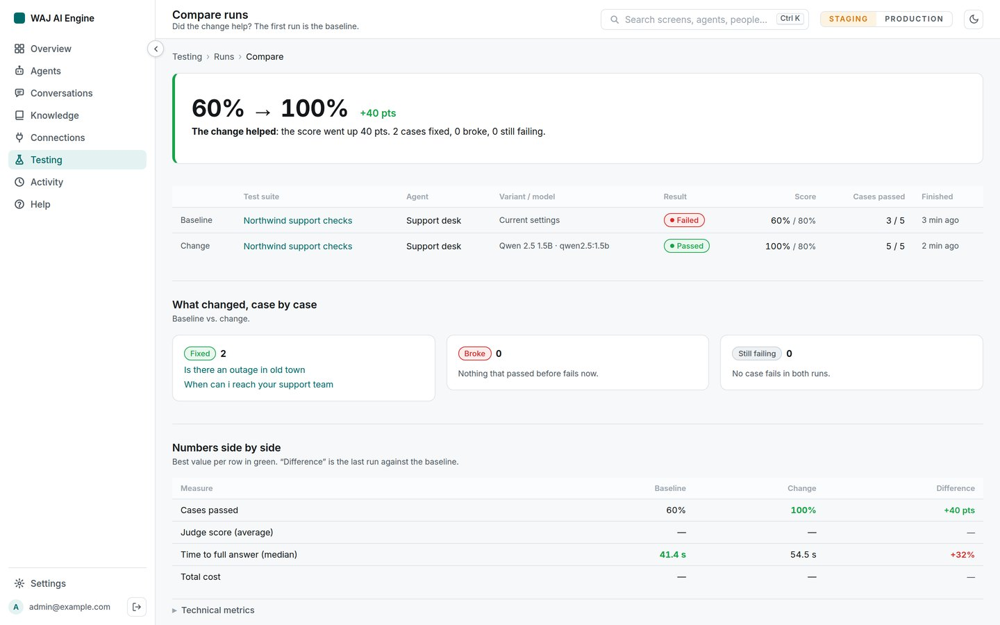
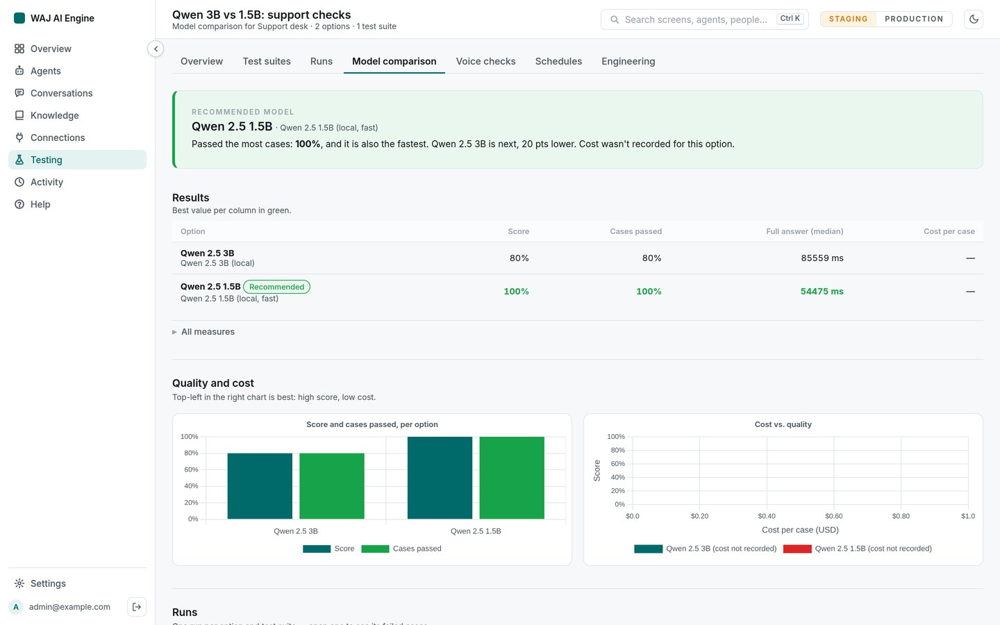

# Testing: know your agent is ready before customers see it

▶ **Full video with sound:** [engine-testing.mp4](media/engine-testing.mp4) (33 s)

A test suite is a set of questions your customers ask, each with the answer you expect. Run it against an agent to get a score against your target and the reason each case failed, then compare runs or AI models to see what helped.

**Where:** **Testing** in the sidebar · **Guides:** [Is each agent good enough?](01-testing-overview.md), [Run a test and read the result](02-run-a-test.md), [Compare results](03-compare-results.md), [Compare models](04-model-comparison.md), [Voice checks](05-voice-checks.md), [Test suites and schedules](06-test-suites.md)

## How it works

### 1. Write a test suite
Each case has a **Category**, the **Question** the customer asks and the **Expected answer**. The top of the suite shows the latest result and the **Run history**.

### 2. Run it
Click **Run this suite**, then **Start run**. The run page opens and fills in as cases finish. You can leave the page; the run carries on.

### 3. Read the result
The top line shows **Passed** or **Failed**, the score and the target, with a sentence such as "3 of 5 cases passed. 20 pts below the target." Click a case to see why it failed, the **Question**, the **Expected** answer and the agent's **Answer**.

### 4. Compare two runs
On the **Runs** tab, tick two runs and click **Compare selected**. The headline shows the score before and after, and the cases are grouped into **Fixed**, **Broke** and **Still failing**.

### 5. Compare models
A model comparison runs the same suites on two or more options and names a **Recommended model**, with a results table and quality and cost charts.

## Good to know
- A run passes when its score reaches the suite's **target score**. 80 to 90% is typical.
- Pick a **Judge model** in the suite's settings so each answer is graded against the expected answer. Without one, only expected words are checked.
- Model comparisons need a judge model on every suite they run.
- Real runs take a few minutes; the video skips the wait.
- **Schedules** grade a sample of real conversations every day or week, and **Voice checks** place scripted calls to voice agents.

## In this section
- [Is each agent good enough?](01-testing-overview.md): one card per agent with its latest score against the target.
- [Run a test and read the result](02-run-a-test.md): start a run, read the verdict and the failed cases.
- [Compare results](03-compare-results.md): see which cases got fixed, broke or still fail between two runs.
- [Compare models](04-model-comparison.md): run the same tests on several AI models and get a recommendation.
- [Voice checks](05-voice-checks.md): scripted phone calls that check a voice agent works.
- [Test suites and schedules](06-test-suites.md): create suites, write good cases and grade real conversations on a schedule.
