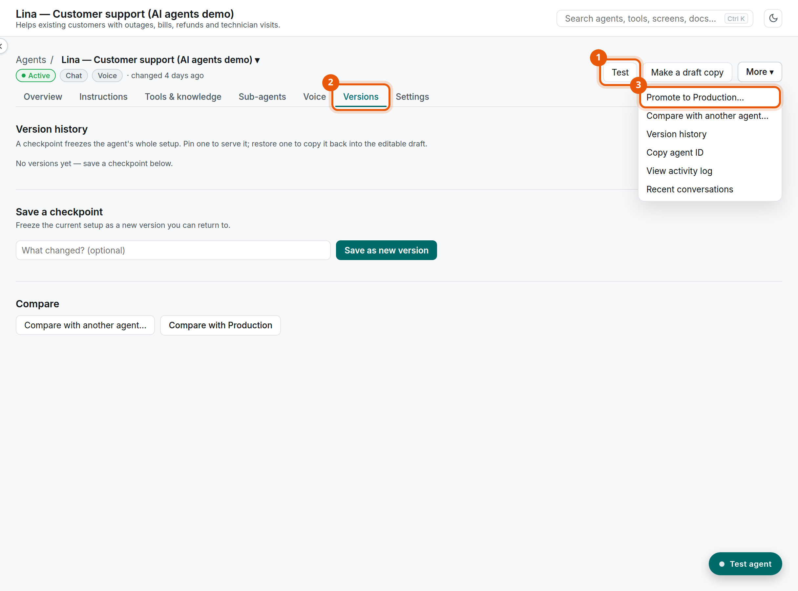

# Make your changes live

In your portal, **a change goes live as soon as you save it**. There's no separate publish button: people get the new setup on their next message, or their next call for voice settings. This page explains how to change things safely, and how to undo a change.

<video src="../media/publishing/save-and-check.mp4" controls muted playsinline width="100%"></video>
*Lina gets a new sign-off line: edit the instructions, save, then check the very next test reply.*

## A safe way to make a change

1. **Save a checkpoint first.** On the **Versions** tab (2), write a note such as "Before new refund rules" and click **Save as new version**. This is your way back.
2. **Make the change** on the right tab and click its Save button: **Save instructions**, **Save tools & knowledge**, **Save sub-agents**, **Save voice settings** or **Save settings**. Write a short **What changed?** note where there's a box for it.
3. **Test straight away.** Click **Test** (1) and try the conversation you changed, plus one or two that should still work as before. See [Test your agent](../02-agents/08-test-your-agent.md).
4. **For bigger changes, run a test suite** and compare the result with the last run. See [Run a test](../06-testing/02-run-a-test.md) and [Compare results](../06-testing/03-compare-results.md).
5. **Keep an eye on real conversations** for the next few hours. See [Review a conversation](../05-monitor/02-review-a-conversation.md).

## Undo a change

- **Instructions:** on the **Instructions** tab, use **Compare versions** to see the earlier text, put it back in the editor, and click **Save instructions**.
- **Anything else, or several tabs at once:** on the **Versions** tab, click **Restore** on the checkpoint you saved before the change. Then check the tabs and test again.
- **Need time to fix it?** **Pin** your last good checkpoint on the **Versions** tab. People get that version while you work. Choose **Default (latest)** again when you're done. See [Save a checkpoint and go back to it](../02-agents/06-versions.md).

## Hold changes back

- A **Draft** agent isn't served to anyone. New agents start as drafts. Switch one to **Active — serves people** in **Settings** when it's ready.
- Pinning a version (see above) keeps people on a known-good setup while you edit.

## About "Promote to Production…"

The **More ▾** menu on an agent shows **Promote to Production…** (3), and the **Versions** tab shows **Compare with Production**. Your portal already serves your agents directly, so you don't need either to make a change live. Leave them alone unless your portal administrator asks you to use them.

## Who changed what

Every save is recorded with who made it and when. Open **Activity** in the sidebar, or **More ▾ → View activity log** on an agent. See [Activity](../08-team-and-settings/02-activity.md).

**Related:** [Change what your agent says](../02-agents/02-instructions.md) · [Test your agent](../02-agents/08-test-your-agent.md) · [FAQ: my change isn't showing](../09-reference/02-faq.md)
