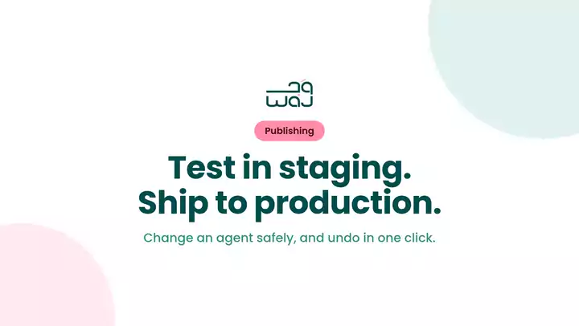
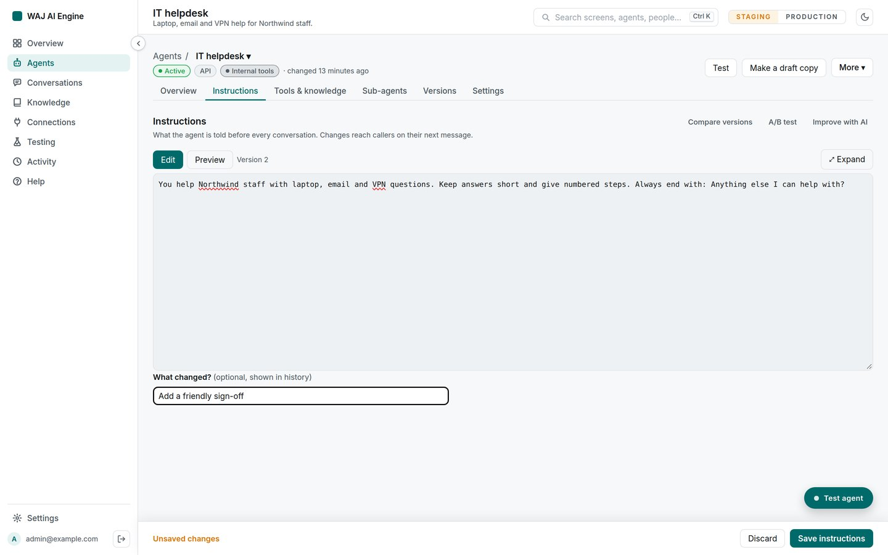
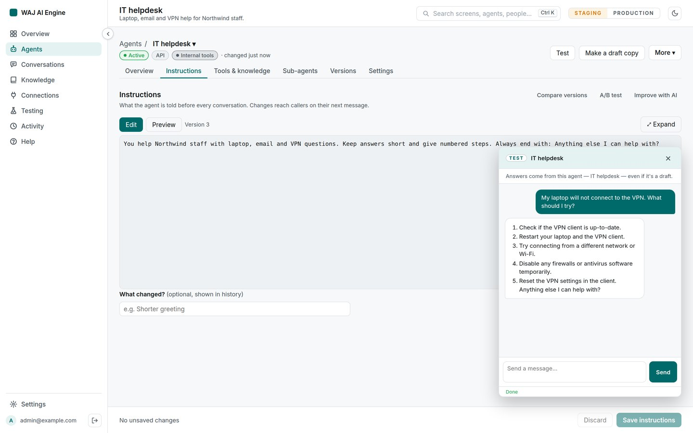
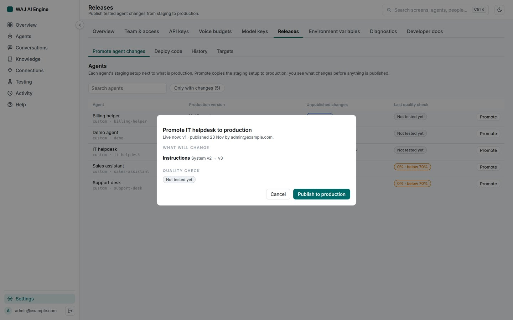
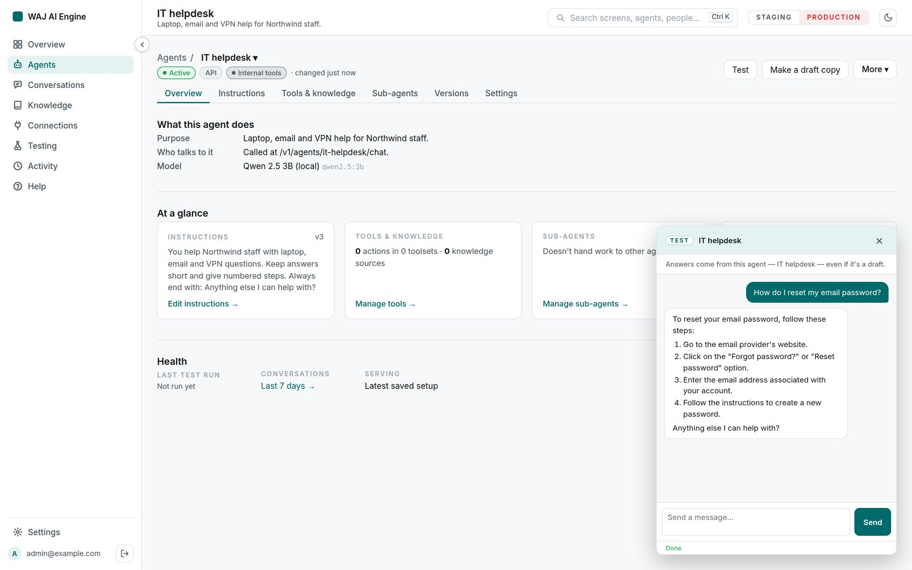
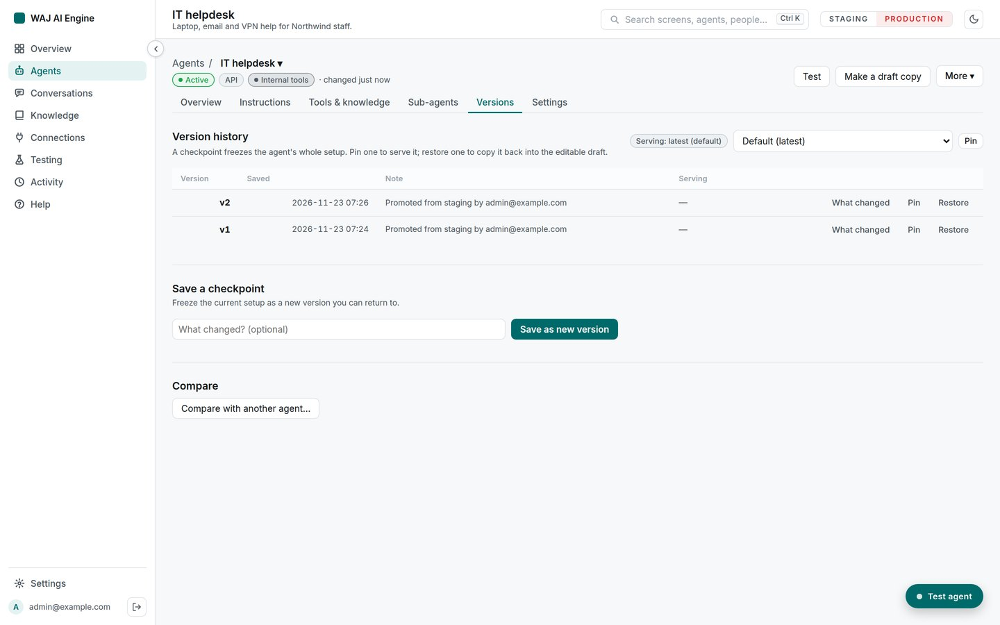

# Publishing: change an agent safely, then ship it

▶ **Full video with sound:** [engine-publishing.mp4](media/engine-publishing.mp4) (37 s)

Change an agent, check the result straight away, and keep a way back. When your portal has a **STAGING / PRODUCTION** switch in the header, you edit in staging, test there, and promote the agent to production when you are happy. Every release is saved as a version you can pin or restore.

**Where:** Agents › your agent, and Settings › Releases · **Guides:** [Make your changes live](01-publish-changes.md), [Save a checkpoint and go back to it](../02-agents/06-versions.md)

## How it works

### 1. Edit in staging
With **STAGING** selected, open the agent's **Instructions** tab, make your change, write a short **What changed?** note and click **Save instructions**. Here the IT helpdesk gets a sign-off line.

### 2. Test it straight away
Click **Test** and try the conversation you changed. The answer now ends with the new sign-off.

### 3. See what will change, then promote
**Settings › Releases › Promote agent changes** lists each agent's staging setup next to production, with its unpublished changes and last quality check. Click **Promote** to see what will change (here: **Instructions**, v2 to v3), then **Publish to production**.

### 4. Production has it now
Switch to **PRODUCTION**: the agent answers with the new line straight away.

### 5. Undo with versions
Each promotion is saved as a version ("Promoted from staging by ..."). On the **Versions** tab, **Pin** a version to serve it, or **Restore** it to copy it back into the editable setup. You are asked to confirm first.

## Good to know
- Save a checkpoint before a big change: on the **Versions** tab, type a note and click **Save as new version**.
- The promote dialog also shows the agent's last quality check, so you can run a test suite first.
- A pinned version is served whatever you edit afterwards. Choose **Default (latest)** again when you are done.
- Without the STAGING / PRODUCTION switch, a change goes live as soon as you save it. See [Make your changes live](01-publish-changes.md).
- Every save and every promotion is recorded in **Activity**.

## In this section
- [Make your changes live](01-publish-changes.md): a safe way to make a change, test it, and undo it.
