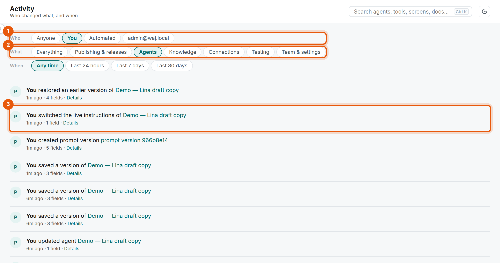

# See who changed what

**Activity** is a record of every change made in the portal: who made it, what changed and when. Use it to find out why an agent started behaving differently, or to check a colleague's change.

## Find a change

Click **Activity** in the sidebar. The newest changes are at the top.

1. **Who**: **Anyone**, **You**, **Automated** (changes the system made by itself, such as scheduled tests) or a named colleague.
2. **What**: **Everything**, or one area: **Publishing & releases**, **Agents**, **Knowledge**, **Connections**, **Testing** or **Team & settings**.

   **When** narrows it to the **Last 24 hours**, **Last 7 days** or **Last 30 days**.
3. Each entry is one sentence, for example "You restored an earlier version of Lina". The underlined name opens the thing that changed. Under it you'll see when it happened and how many fields changed.

Hover over a time such as "5m ago" to see the exact date and time.

## See exactly what changed

Click **Details** under an entry. You'll see:

- **Who**, **What**, **Item** and **When**.
- **Changes**: each field that changed, with its value before and after (old → new).

**Technical details and raw data** at the bottom is for engineers. You can usually leave it closed.

## Shortcuts

- On an agent's page, **More ▾ → View activity log** shows that agent's changes only.
- On **Team & access**, the **Activity** link shows who gained or lost access.

## Good habits

- When you save instructions, fill in **What changed?**. Your note shows in the history, so your team knows why.
- If an agent suddenly behaves differently, look here first, with **What** set to **Agents**. Then compare or restore an earlier version. See [Versions](../02-agents/06-versions.md).

**Related:** [Choose who can use the portal](01-team.md) · [Make your changes live](../07-publishing/01-publish-changes.md) · [Versions](../02-agents/06-versions.md)
