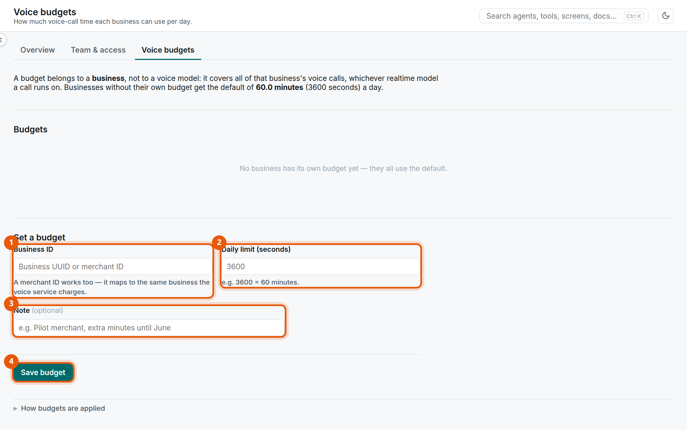

# Set the daily voice allowance

A voice budget caps how many minutes of voice calls a business can use each day, so costs can't run away. Every business gets a default allowance. You can give one business more or fewer minutes.

## How it works

- The allowance belongs to a **business**, not to a voice. It covers all of that business's voice calls.
- A business without its own budget gets the default. The top of the page shows how much that is, for example **60.0 minutes** (3600 seconds) a day.
- **Budgets** lists every business with its own allowance. If none has one yet, the page says they all use the default.
- A budget applies as soon as you save it.

## Set a budget

Click **Settings** at the bottom of the sidebar, then **Voice budgets**.

1. In **Business ID**, enter the business's ID. Ask your portal administrator if you don't know it.
2. In **Daily limit (seconds)**, enter the allowance in seconds. Multiply minutes by 60: 30 minutes is 1800, 60 minutes is 3600, 2 hours is 7200.
3. In **Note**, write why, for example "Pilot customer, extra minutes until June". This is optional, but it helps your team later.
4. Click **Save budget**.

The business now appears under **Budgets**. To change its allowance, set a budget for the same business again.

## Check how much is being used

On the **Overview**, the **Voice calls** section shows minutes used in the period and **Today vs daily allowance**. See [Read the Overview](../05-monitor/01-overview.md).

## Good to know

- When a business reaches its allowance, new calls are refused until the next day.
- If usage can't be checked for a moment, calls are allowed. The budget controls cost, not whether calls work.
- Each change is recorded in [Activity](02-activity.md).

**Related:** [Choose who can use the portal](01-team.md) · [Voice settings](../02-agents/05-voice.md) · [Read the Overview](../05-monitor/01-overview.md)
