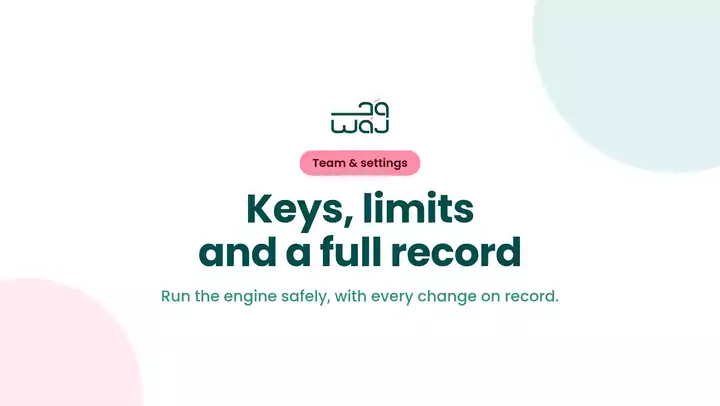
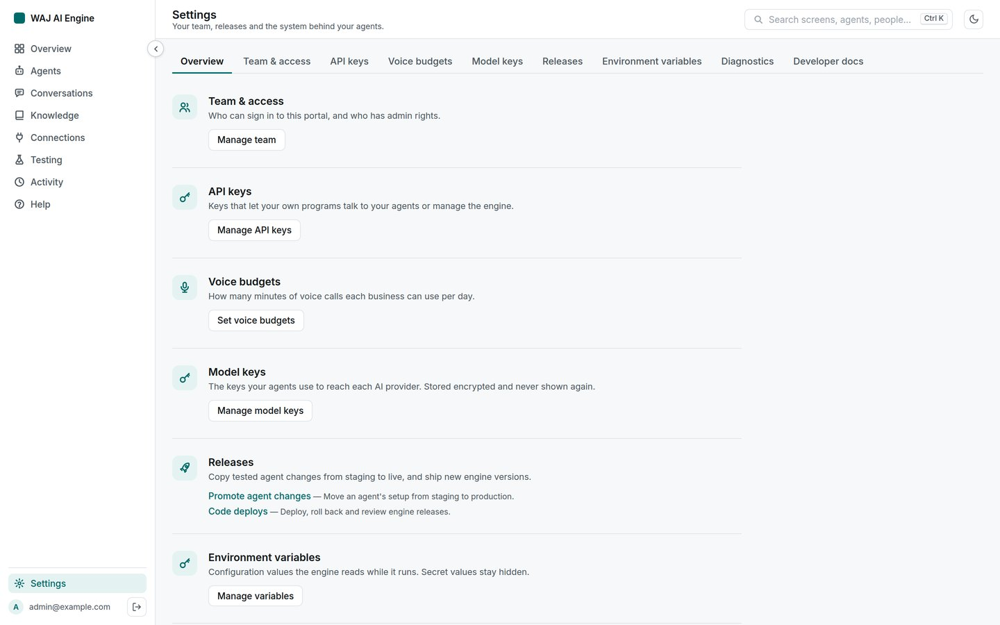
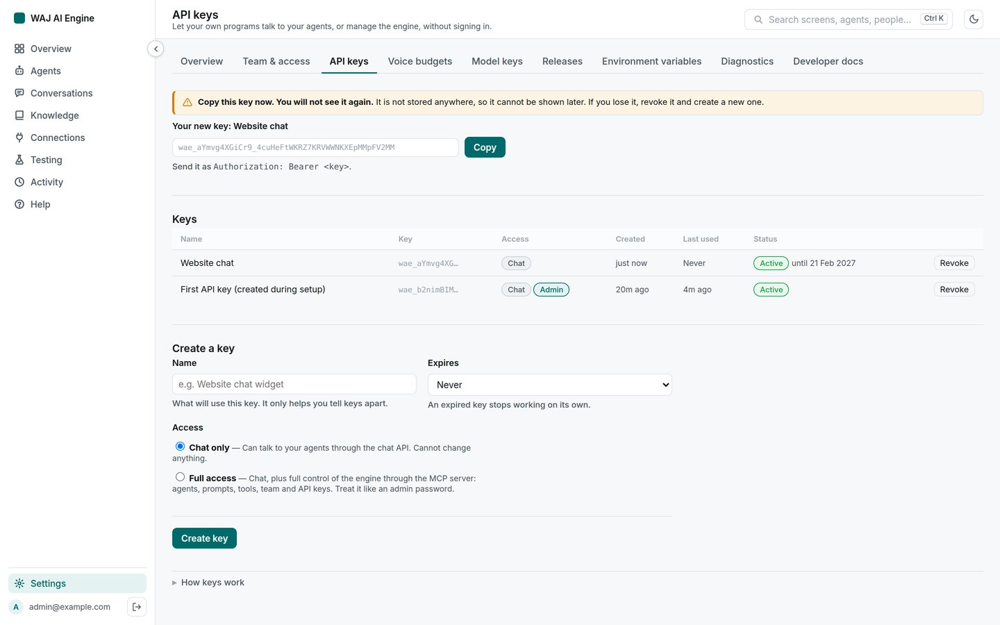
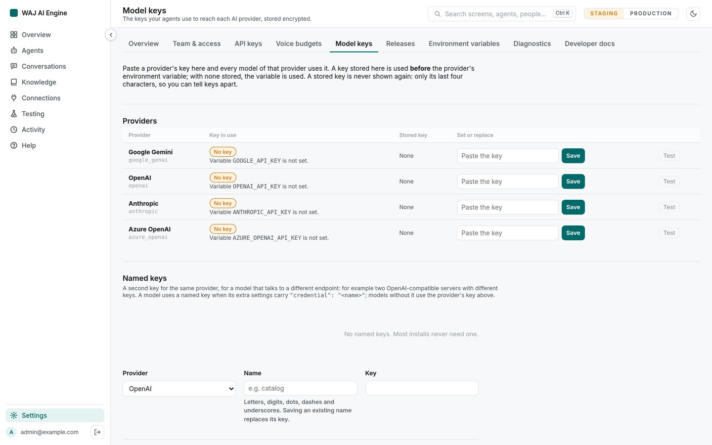
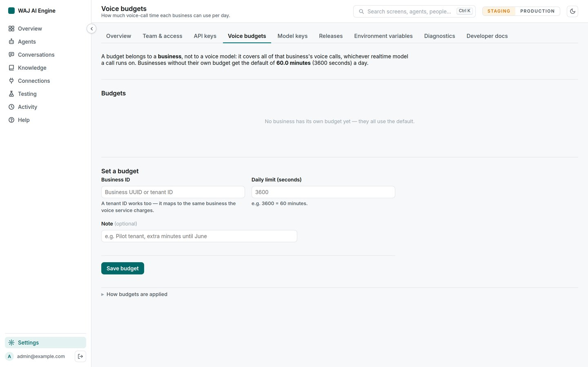
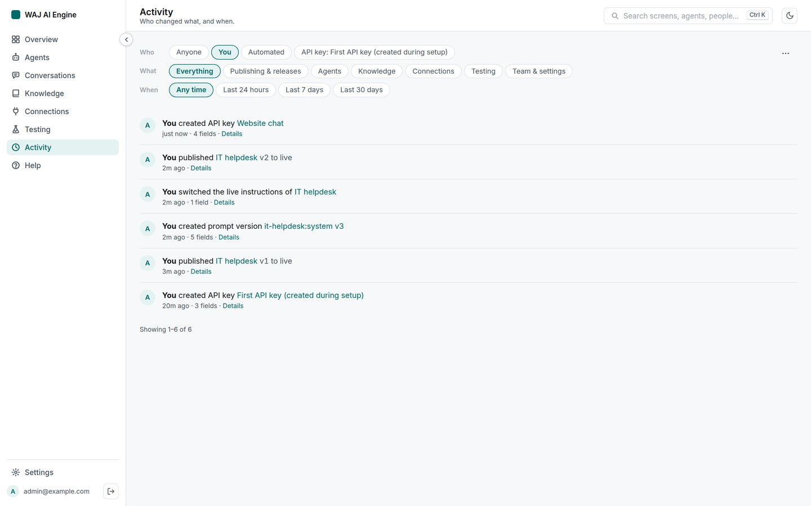
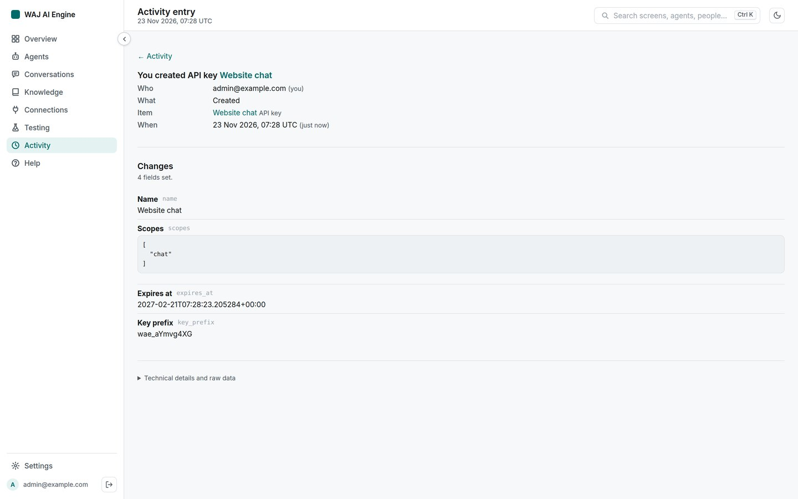

# Team & settings: keys, limits and a full record

▶ **Full video with sound:** [engine-team-and-settings.mp4](media/engine-team-and-settings.mp4) (36 s)

Settings keeps the things that run your engine in one place: who can sign in, the API keys your programs use, daily voice allowances and your AI provider keys. **Activity** records every change, with who made it and when.

**Where:** Settings (bottom of the sidebar) and Activity · **Guides:** [Choose who can use the portal](01-team.md), [See who changed what](02-activity.md), [Set the daily voice allowance](03-voice-budgets.md), [Create and revoke API keys](04-api-keys.md), [Add a model key](04-model-keys.md)

## How it works

### 1. Open Settings
One page with **Team & access**, **API keys**, **Voice budgets**, **Model keys** and more.

### 2. Create an API key
Under **Create a key**, type a name such as "Website chat", pick when it **Expires**, choose **Chat only** and click **Create key**. The key is shown once: click **Copy** and put it where it will be used. A Chat only key can talk to your agents but can't change anything.

### 3. Add a model key
**Model keys** lists each provider (Google Gemini, OpenAI, Anthropic, Azure OpenAI) and which key is in use. Paste the key under **Set or replace** and click **Save**, then **Test**. Keys are stored encrypted and never shown again.

### 4. Set a daily voice allowance
**Voice budgets** caps how many seconds of voice calls a business can use each day. Businesses without their own budget get the default shown at the top.

### 5. See who changed what
**Activity** lists every change, newest first. Filter by **Who**, **What** and **When**.

### 6. Open the details
Click **Details** to see who, what, the item, when, and each field that changed.

## Good to know
- Revoke a key as soon as you think someone else may have seen it. A revoked key can't be turned back on.
- A key saved under Model keys is used before the server's environment variable for that provider.
- **Team & access** lists the people who can sign in. Make someone an admin, or remove their admin access, from their row.
- Creating and revoking keys, budget changes and access changes are all recorded in Activity.

## In this section
- [Choose who can use the portal](01-team.md): give or remove admin access.
- [See who changed what](02-activity.md): find a change and see exactly what changed.
- [Set the daily voice allowance](03-voice-budgets.md): cap voice minutes per business per day.
- [Create and revoke API keys](04-api-keys.md): let your own programs use your agents.
- [Add a model key](04-model-keys.md): connect an AI provider.
