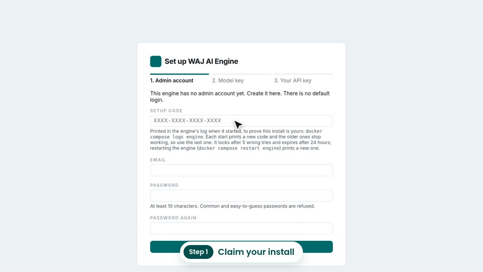
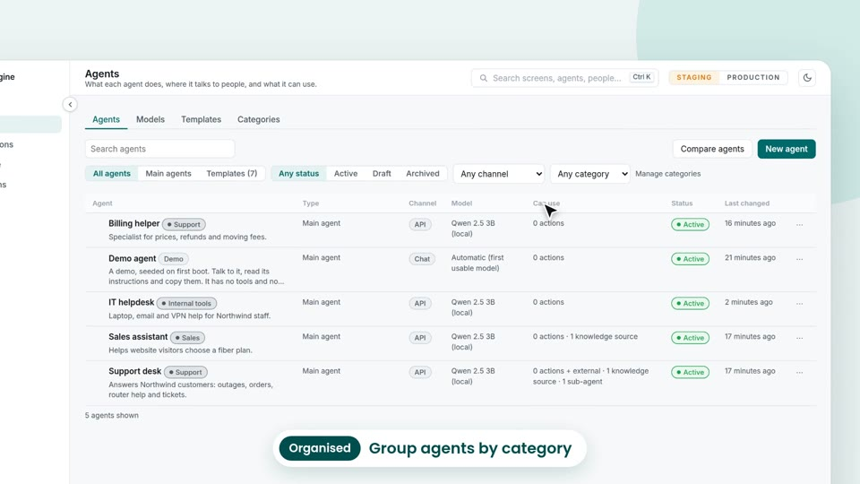
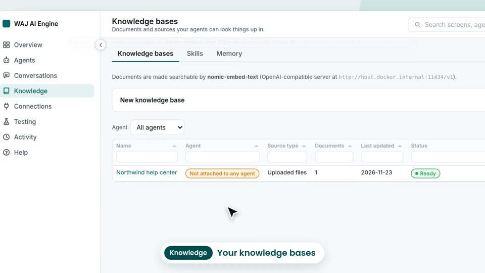
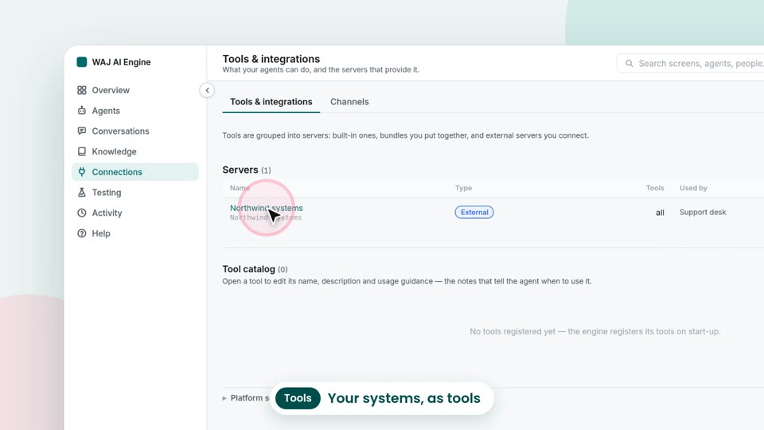
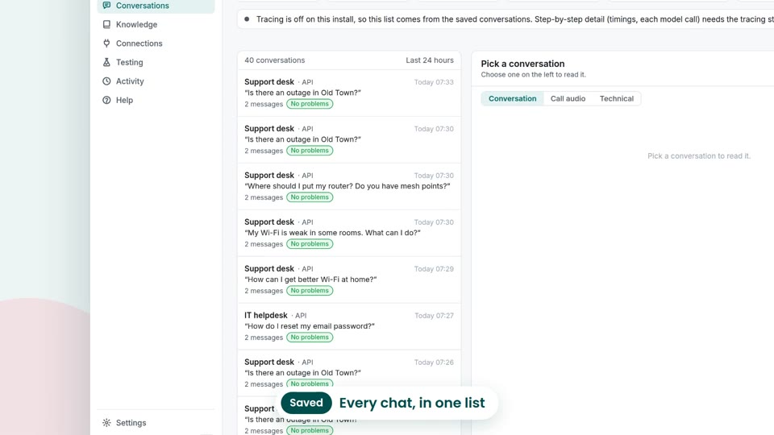
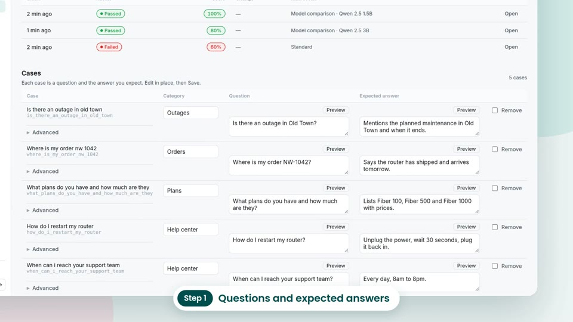
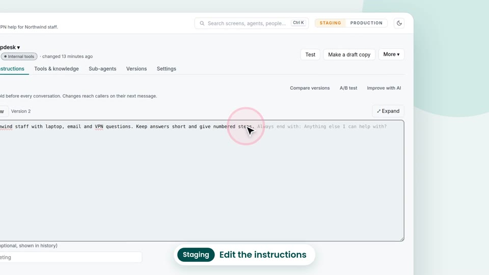
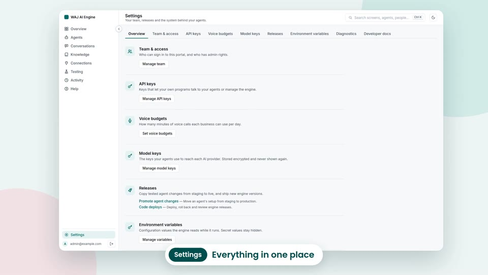

# Help

These guides show you how to look after your AI agents in the portal: change what they say, test them, check how real conversations went and fix what goes wrong. No coding is needed.

## Start here

1. [Welcome to the portal](01-getting-started/01-welcome.md): what each part of the sidebar is for.
2. [Your first 15 minutes](01-getting-started/02-first-15-minutes.md): look at an agent, test it and read a real conversation.
3. [Find anything](01-getting-started/03-find-anything.md): jump to any screen, agent or guide with **Ctrl K** (**⌘ K** on a Mac).
4. [Set up a new install](01-getting-started/04-set-up-a-new-install.md): only if you installed the engine yourself and nobody has an account yet.

## Watch it first

Every section has a short video and a page with screenshots.

| | |
|---|---|
|  | **[Getting started](01-getting-started/)** Up and running in minutes  ▶ 36 s video |
|  | **[Agents](02-agents/)** Agents that get things done  ▶ 40 s video |
|  | **[Knowledge](03-knowledge/)** Teach your agents what you know  ▶ 37 s video |
|  | **[Connections](04-connections/)** Plug agents into your systems  ▶ 36 s video |
|  | **[Monitor](05-monitor/)** Read every conversation your agents have  ▶ 35 s video |
|  | **[Testing](06-testing/)** Know your agent is ready before customers see it  ▶ 33 s video |
|  | **[Publishing](07-publishing/)** Change an agent safely, then ship it  ▶ 37 s video |
|  | **[Team & settings](08-team-and-settings/)** Keys, limits and a full record  ▶ 36 s video |

## All guides

| Section | What it covers |
|---|---|
| [Getting started](01-getting-started/01-welcome.md) | A tour of the portal and your first steps. |
| [Agents](02-agents/01-your-agents.md) | Change what an agent says and does: instructions, tools, voice and versions. |
| [Knowledge](03-knowledge/01-knowledge-bases.md) | The documents, skills and memory your agents use to answer. |
| [Connections](04-connections/01-tools-and-integrations.md) | Tools, integrations and the channels customers reach you on. |
| [Monitor](05-monitor/01-overview.md) | See how your agents are doing and read real conversations. |
| [Testing](06-testing/01-testing-overview.md) | Check each agent's quality with test suites and voice checks. |
| [Publishing](07-publishing/01-publish-changes.md) | How your changes reach customers, and how to undo one. |
| [Team & settings](08-team-and-settings/01-team.md) | Who can sign in, who changed what, daily voice minutes, API keys and model keys. |
| [Reference](09-reference/01-glossary.md) | Words used in the portal, common questions, and working from an AI assistant. |

## Need a hand?

Start with the [questions people often ask](09-reference/02-faq.md). If you're still stuck, contact the team that runs your portal. A link to the conversation helps: open it in **Conversations** and click **Copy link**.
